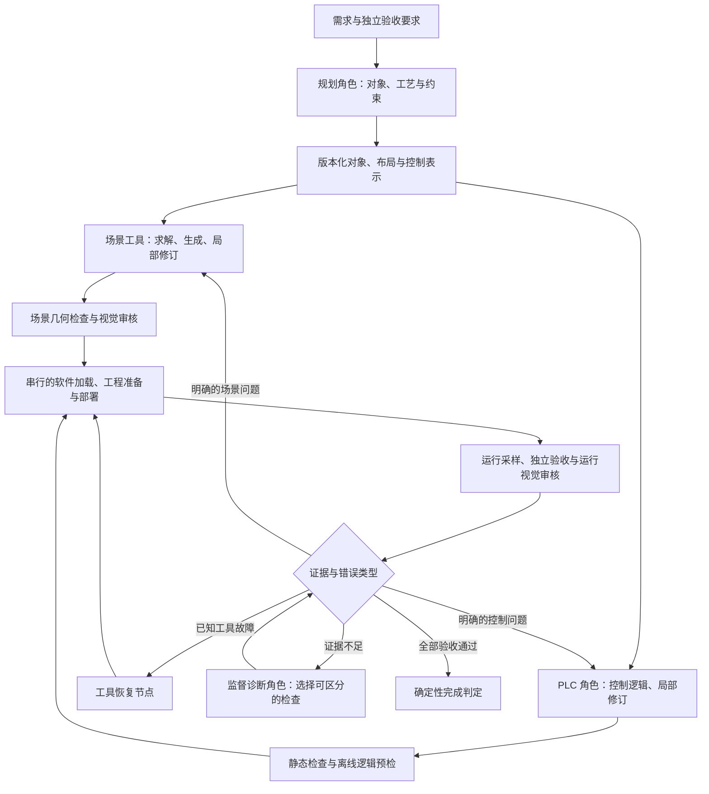

# Agent 框架效率审计与改造建议（2026-10-11）

结论：模型确实产生过格式和控制逻辑错误，但已经有直接证据证明编排、上下文和工具恢复
也在放大失败成本。应先处理这些确定的问题，再用固定任务对照实验评估模型差异。
现有调试历史不能给出“模型占多少责任、框架占多少责任”的百分比。

本次只读取历史运行和源码，新增通用审计脚本、统计文件及本文；没有调用模型、启动仿真
或修改已通过的框架运行逻辑。

## 数据口径与实测开销

统计命令：

```powershell
& .\.venv\Scripts\python.exe tools\audit_agent_efficiency.py --runs-root runs --glob 'observer-sc001-*' --out artifacts\agent-efficiency-audit-20261011\metrics.json
```

输出必须使用新文件，脚本不覆盖旧统计。按 `candidate_id` 去除恢复目录中的复制记录，
仅计 `source_kind=live_model`；不输出原始请求内容或凭据。原始统计：
[metrics.json](../artifacts/agent-efficiency-audit-20261011/metrics.json)。

| 项目 | 实测值 |
|---|---:|
| SC001 调试目录 | 34 |
| 模型候选文件 / 去除的重复副本 | 393 / 198 |
| 唯一调用记录 | 195 |
| 有用量记录的调用 / 未结束、缺用量的调用 | 194 / 1 |
| 输入 / 输出 / 总 token | 4,320,931 / 294,128 / 4,615,059 |
| 输入占已记录总 token | 93.63% |
| 携带格式或合同纠错反馈的调用 | 44 |
| 已记录模型调用延迟之和 | 2,647 秒 |

token 包含服务商报告的缓存和图片 token，不能直接换算为费用；延迟之和不包含人工修改、
UAC 等待、IDE 和仿真执行时间。范围不包括独立 `--investigate` 产物或其他目录。
这 34 个目录使用过不同提示词、代码、配置和模型，属于开发调试历史，不能用 1/34 当作
当前框架成功率。历史失败分类来自当时审计器，也不能自动当作独立确认的根因。

| 角色 | 唯一调用记录 | 已记录输入 token | 已记录输出 token |
|---|---:|---:|---:|
| Planner | 73 | 781,393 | 99,833 |
| Scene | 58 | 891,201 | 75,120 |
| PLC | 23 | 603,114 | 63,526 |
| Vision | 34 | 1,757,673 | 30,424 |
| Supervisor | 7 | 287,550 | 25,225 |

第 034 轮是一个更有解释力的例子：任务、场景和 PLC 全部复用，仍执行 4 次模型调用。
其中场景审核第一次输出不是对象，随后进行了格式纠错；它不是零错误的一次通过。

| 第 034 轮调用 | 输入 token | 输出 token | 用途 |
|---|---:|---:|---|
| 场景视觉首次调用 | 33,395 | 2 | 格式错误 |
| 场景视觉纠错 | 33,459 | 442 | 审核通过 |
| 运行视觉审核 | 62,617 | 464 | 审核通过 |
| 最终监督 | 14,133 | 241 | 当时只允许选择 done |
| 合计 | 143,604 | 1,149 | 总计 144,753 token |

本轮从创建到最后记录的模型完成约 158.7 秒：编译/工程准备/下载阶段 71.8 秒，实测与
操作采样 39.3 秒，场景加载 5.0 秒，连接 3.3 秒；模型延迟之和 34.9 秒。
这些统计不含完整进程未记录的尾部开销。只压缩模型输入，不能消除 CODESYS 这一部分耗时。

模型用量已从本轮四个独立候选再次求和交叉核对；195 个唯一候选也恰好各归属一个引入它
的运行，没有重复计入。统计源文件没有不同内容的同 ID 版本，也没有 JSONL 解析缺失。

## 已确认的问题与尚未确认的推断

| 问题 | 证据 | 对改造的含义 |
|---|---|---|
| 角色输入仍过大 | 第 034 轮场景审核同时携带完整 task、I/O、manifest 和 evidence；运行审核再携带 PLC。字段体积见 metrics 的 largest_payload_fields_characters | 按决策所需生成角色视图，模型按 ID 请求更多证据；完整数据保留在产物库 |
| 已确定的下一步仍问模型 | 3 次最终监督调用的 allowed_actions 长度为 1，第 034 轮只有 done | 规则能确定的路由直接执行；模型仅处理有真实歧义的判断 |
| 全局监督尚未驱动持续调度 | cli.py 在 workflow.run/resume 返回后调用 decide；执行器内部只在特定运行失败分支调用 investigate | 当前主要是串行工作流加局部诊断；需要独立、持久化的调度状态，不能只换监督 prompt |
| 恢复粒度较粗 | memory.py 复用 task/scene/plc，但明确要求加载、视觉、编译下载和运行重做 | 按节点和依赖失效恢复；涉及在线软件状态的复用必须新增身份验证工具 |
| 修复通常重新生成完整 PLC 逻辑片段 | PLCAgent.program 要求完整 fragment，外层重新导出与部署 | 支持局部语义补丁，保护无关的已通过逻辑，并进行回归预检 |
| 重试预算以局部次数为主 | 各角色 range(3)、调查 range(2)、外层 scene/plc 修订限制；无任务级总调用/token/时间预算 | 保留已有无进展检测，增加跨节点的总预算和重复失败检测 |
| 工具/审计错误确实阻止了已可行任务 | 第 031 轮 14/14 实测通过却因角色集合相等检查被拒绝；第 033 轮成功检查点 failure=None 导致 AttributeError | 增加状态转换与恢复路径的集成验证，而非继续增加相同实现的单元测试 |
| 模型也确实出错 | 第 034 轮视觉返回非对象；此前 PLC 的停留/出口逻辑错误、未声明赋值目标、输出截断 | 需要更好的接口、静态及逻辑预检；模型能力仍须单独测量 |

阶段文件哈希、独立验收、真实软件回执和来源记录应保留。它们提供了诊断依据。
311 项离线测试通过并不等于多场景端到端可靠；SC001 修好也不证明泛化已经解决。

## 对照成熟系统，借鉴什么

| 资料 | 设计思想 | 本项目的对应改造 |
|---|---|---|
| [Anthropic: Building effective agents](https://www.anthropic.com/engineering/building-effective-agents) | 按需求选择简单工作流、路由或有界评价改进，关注模型与工具接口 | 保留明确阶段，减少无信息增益的模型调用；验证“这一角色是否带来改善” |
| [LangGraph: Thinking in LangGraph](https://docs.langchain.com/oss/python/langgraph/thinking-in-langgraph) 与 [Persistence](https://docs.langchain.com/oss/python/langgraph/persistence) | 独立节点、共享原始状态、节点内生成上下文、区别处理错误，使用持久化检查点 | 将当前嵌套循环拆成可恢复的执行图；SQLite 持久化可作为本机候选方案，迁移前验证依赖和行为 |
| [SceneGenAgent 论文](https://arxiv.org/html/2410.21909v2) 与 [官方仓库](https://github.com/THUDM/SceneGenAgent) | 对象检索、布局关系提取、结构化布局验证，再按模板/API 指导生成代码 | 让模型解决空间/工艺决策，工具负责稳定的格式、数值、I/O 与编译工作 |

SceneGenAgent 的论文对象是 Tecnomatix/Process Simulate 场景布局与代码生成，不能把其
指标解释成 Factory I/O 与 PLC 闭环成功率。其无可用对象时允许移除对象的处理也不能直接
照搬本项目：关键工艺能力缺失仍须报告未决需求。

[Anthropic 多 agent 研究系统经验](https://www.anthropic.com/engineering/multi-agent-research-system)
还指出，强依赖、共享大量上下文的任务不适合直接照搬高度并行的研究型架构。
据此推断，本项目更适合确定性执行图配合按需调用的专家角色；同一 Factory I/O 场景的
写操作须串行锁定，可以并行的是独立的设计/检查步骤，而不是多个角色同时修改软件。

上述资料提供设计原则；没有任何一家通用库能自动解决 Factory I/O 的几何语义、PLC 的
周期控制或软件在线身份问题。采用 LangGraph 也仍需保留并完善现有原生工具适配层。

## 建议的执行结构（设计，尚未实现）



共享状态存储当前节点、产物版本、依赖、在线会话身份、错误证据和剩余预算；原始长轨迹
在产物库保存。角色只收到当前决策需要的视图。调查反馈必须有新的检查结果或修复方案，
不能在 I/R 之间无预算、无进展地循环。

控制表示可以逐步加入状态、转移、计时器、优先级、动作及输出默认值，工具将模型选择的
控制语义编译为 ST。这是通用工艺原语与编译器，不是给每个场景手写一套完成逻辑。
表示不支持的复杂逻辑应显式报告，不可偷偷简化；既有 ST 路径可作为经过约束的回退方案。

## 改造顺序与评价方式

1. **先收紧上下文和调度。** 给场景视觉、运行视觉、PLC 修复和监督分别定义最小视图。
   只有唯一允许动作时直接由工具执行并记录决定。完整原件、版本校验、模型原始回复和
   新鲜的最终验收继续保留；如工具补入版本元数据，记录可重放的派生产物来源。
2. **再拆节点和恢复边界。** 独立建模规划、布局、配置、加载、编译、部署、连接、采样、
   审核和调查。静态产物按内容/依赖复用；在线步骤先核对会话、已加载场景和 PLC 应用身份。
   缺少身份校验工具时继续执行原检查，不能直接缓存过去的 Run 或验收结果。
3. **增加便宜的预检和局部修复。** 保持原需求与独立验收不变；先做语法/符号检查和
   离散控制逻辑检查，再进入慢的 CODESYS/仿真周期。失败只改相关布局或控制片段。
   离线模型不能替代物理、连接、强制/故障状态和当前视觉验收。
4. **建立固定评测后再决定模型及训练投入。** 先使用 5–10 个覆盖停留时间、按钮极性、
   出口事件、布局边界和恢复行为的已定义测试任务；冻结输入、工具、验收标准与版本。
   同一模型比较现有/改进编排，再在同一改进编排下比较可用模型。每个任务重复运行，
   单独记录零人工干预的首次通过率、最终通过率、人工介入次数、模型/工具调用数、
   token、端到端耗时、重复失败和需求退化。候选指标须同时衡量成功与成本。

这一轮没有执行上述新评测，也未证明任何新结构的提升百分比。历史问题和审计样本可用于
设计评测，但不能一边修评测集一边把成功算成固定版本成绩。LoRA-SFT 仍按原方向推进，
角色接口和任务定义稳定后再整理相应的高质量轨迹；未经审核的失败修复不会自动变成正样本。

所有改造均应保留现有已经可用的 Factory I/O/CODESYS 适配、检查点和训练来源，再逐步替换
编排部分。优先建立效率基线与小范围对照，避免一次重写全部工具导致重新走完整调试流程。
