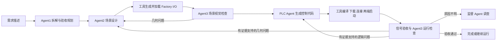

# 工业自动化仿真 Agent 框架使用说明书

核对日期：2026-10-11。适用于本机 Windows、Factory I/O、CODESYS 和项目内的 `run_agents.py`。所有 PowerShell 命令默认在 `F:\phd\project\digital-twin-factoryi-o` 执行。

## 1. 先找到材料和运行结果

| 内容 | 位置 | 用途 |
| --- | --- | --- |
| 100 个项目的设计材料 | `scenario_projects/` | 需求、对象、工艺拓扑、布局约束、PLC 思路、验收草案、参考来源 |
| 100 项总目录 | [scenario_projects/README.md](../scenario_projects/README.md) | 按名称浏览项目，点击进入每项设计 |
| 可筛选的项目表 | [catalog.csv](../scenario_projects/catalog.csv) | 用 Excel 查看编号、工艺族、难度、路径、状态 |
| 结构化项目索引 | [catalog.json](../scenario_projects/catalog.json) | 给程序读取项目元数据 |
| 推荐实施顺序 | [curriculum.md](../scenario_projects/curriculum.md) | 首批 20 项试点、依赖和后续扩展顺序 |
| 实际执行产物 | `runs/<运行目录>/` | 生成的场景、PLC 工程、模型轨迹、截图、软件回执和验收结果 |
| 早期适配和联调材料 | `artifacts/` | 软件分析、工具验证、历史手工基线；是否使用模型须看各自记录 |
| 项目经验记忆 | `agent_memory/experiences/` | 历次任务摘要和失败经验 |
| 训练运行索引与审核目录 | [training_data/](../training_data/README.md) | 运行位置索引、人工审核、SFT/DPO 导出 |

已核实有 **100 个项目子目录，覆盖 10 个工艺族**，难度为 L1 20 项、L2 30 项、L3 30 项、L4 20 项。当前 `catalog.json` 中 100 项均为 `planned`。这是设计库的登记状态；实际实验是否完成，要查看对应 `runs` 的验收证据。CLI 目前不会自动回写设计库状态。

### 每个项目里有什么

以 [SC001_single_conveyor](../scenario_projects/SC001_single_conveyor/design.md) 为例：

```text
scenario_projects/SC001_single_conveyor/
├── design.md                 人阅读的完整设计
├── project.json              结构化需求、工艺、约束和交付门
├── io-plan.csv               I/O 语义草案，尚不是实际 GUID/地址绑定
├── acceptance-plan.json      待执行的验收用例草案
├── sources.md                参考来源及用途
└── materials/
    ├── README.md             材料清单和当前缺项
    ├── references/           参考附件、视频时间戳、许可记录
    ├── scene/                场景交付材料或运行目录引用
    ├── plc/                  PLC 交付材料或运行目录引用
    ├── evidence/             运行和验收证据索引
    └── training/             候选、审核和训练发布索引
```

这些 `materials` 子目录目前主要是预留位置；参考链接不代表视频、附件已经下载，设计草案也不代表 `.factoryio` 或 `.project` 已生成。实际运行默认写入 `runs`，不会自动复制到这些子目录。归档时应优先记录运行目录、版本和哈希引用，避免重复复制整个运行目录。

### 已有实验在哪里

| 实验记录 | 本次核对结果 |
| --- | --- |
| [SC001 第 034 轮](../runs/observer-sc001-20261011-034/result.json) | 历史运行报告 `live_pipeline_passed=true`；使用模型产物并重新完成当次联机验收 |
| [EXP002 简单直线输送第 005 轮](../runs/observer-simple-transfer-20261011-005/result.json) | `live_pipeline_passed=false`，状态 `needs_attention`；启动和运行采集完成，但入口检测及后续工艺检查未通过 |

EXP002 是新的实验编号，**不对应设计库的 SC002**。历史通过记录描述当次测量窗口，不代表软件现在仍在运行，也不代表同工艺全部用例已经完成。

## 2. 框架如何完成一个需求



监督角色结合阶段、版本、失败证据和可恢复产物决定下一步。只有一个合法动作时用规则路由；存在歧义时才请求模型。它不能跳过验收门直接宣布成功。

模型负责规划、场景方案、PLC 控制逻辑和视觉判断；工具负责 XML/GUID 组合、坐标解算、I/O 绑定、软件操作和独立验收。运行中不要手工改生成场景、ST、提示词或框架源码，否则可能导致版本检查失效。

## 3. 启动前的准备

1. 打开 Factory I/O。当前本机配置依赖已安装的进程内桥接和 Web API；正常工作时，框架自动保存、加载、截图，不需要每轮手动导入或敲 Console 命令。桥接未加载时先检查，初始化细节见 [Factory I/O 内部自动化说明](factoryio-internal-automation.md)。
2. CODESYS Gateway 和 Control Win Runtime 服务应可用。框架会在模型工作前预检服务，并在权限允许时启动服务；服务运行和 PLC 应用处于 Run 是两个独立状态。
3. 使用当前 Windows 用户运行项目 Python，保持模型和设备配置可读。
4. 同一套 Factory I/O/CODESYS 实例一次执行一个联机任务，避免两个场景同时加载或下载。

配置位置：

| 文件 | 内容 |
| --- | --- |
| [config.agent.json](../config.agent.json) | CLI 默认配置：模型路由、工具命令、部署、同步生命周期、验收和预算 |
| `LLM_Config.yaml` | 用户配置的服务地址、模型及访问配置；文本角色使用 DeepSeek，视觉角色使用 AliyunLLM |
| `secrets/codesys-device.dpapi` | 当前 Windows 用户保护的 PLC 设备凭据 |
| `C:\Users\tongqingwang\Documents\example1.project` | 已跑通的 CODESYS 模板；框架操作输出目录中的副本 |

无需激活虚拟环境，直接使用 `.venv\Scripts\python.exe`。不要用管理员 USER 账户代替当前用户读取 DPAPI 文件；需要服务权限时单独启动服务即可。

### 第一步：只读预检

```powershell
Set-Location -LiteralPath 'F:\phd\project\digital-twin-factoryi-o'
$env:PYTHONIOENCODING = 'utf-8'
& .\.venv\Scripts\python.exe run_agents.py --check
```

检查模型配置和本地接口，不发起场景生成模型请求，也不执行联机部署。它不是完整的模型推理或物理运行验收。输出目录由 CLI 给出，检查问题看该目录的报告。

如果明确报告 Runtime 停止且 Windows 拒绝启动，在**以管理员身份打开的 PowerShell** 执行已有脚本：

```powershell
& 'F:\phd\project\digital-twin-factoryi-o\tools\start-codesys-runtime.ps1'
```

这个脚本启动已检查的服务，保存服务回执；不下载或启动 PLC 应用。随后回到原用户终端重新预检。

## 4. 运行框架

### 用一句需求启动

```powershell
$taskRun = Join-Path 'runs' ('my-simple-transfer-' + (Get-Date -Format 'yyyyMMdd-HHmmss'))
& .\.venv\Scripts\python.exe run_agents.py '构建简单直线输送场景：一条输送带、单件供料器、入口和出口光电传感器、末端移除器。一次只允许一箱在线，入口确认后停止供料，完成输送和移除后再供下一箱；运行时输送带保持运行，停止和复位需同步操作 Factory I/O 与 PLC。' --scenario-id EXP003 --lineage-group simple-transfer --keep-running --out $taskRun
$taskExitCode = $LASTEXITCODE
```

这是待验证的新实验需求，不保证首次生成就通过。场景和代码由框架的模型角色生成，后续软件操作由框架工具完成。

`--out` 必须是**不存在的新目录**。不传时 CLI 在 `runs` 下自动命名；运行结束会打印完整路径。首次启动可以只有 Factory I/O 编辑场景，但前提是本机桥接已经工作。

默认 `run` 执行完整流程，验收结束后停止两端。`--keep-running` 只有在完整验收通过后才执行两端复位、重启和新的运行窗口检查；再次检查通过后保持运行。具体规则以模型生成的合同为准，普通运行不会自动覆盖 100 个项目设计库中的全部测试。

### 从 100 项设计中选择一项

先阅读该项目 `design.md` 和 `acceptance-plan.json`，再把明确的工艺约束传给 CLI。例如读取 SC001：

```powershell
$taskSpec = Get-Content -LiteralPath '.\scenario_projects\SC001_single_conveyor\project.json' -Raw -Encoding UTF8 | ConvertFrom-Json
$taskPrompt = @"
实现项目 $($taskSpec.id)：$($taskSpec.title)。
需求：$($taskSpec.requirement)
工艺拓扑：$($taskSpec.process_graph.expression)
布局约束：$($taskSpec.layout_constraints)
控制计划：$($taskSpec.controller_plan)
验收目标：$($taskSpec.acceptance)
物料契约：$($taskSpec.material_contract | ConvertTo-Json -Depth 20 -Compress)
依据本机可用部件和工具实现；需要标定的参数应先验证，缺少关键能力时明确报告未决项。
"@
$taskRun = Join-Path 'runs' ($taskSpec.id + '-' + (Get-Date -Format 'yyyyMMdd-HHmmss'))
& .\.venv\Scripts\python.exe run_agents.py $taskPrompt --scenario-id $taskSpec.id --lineage-group $taskSpec.template_group --out $taskRun --keep-running
```

把路径换成其他项目即可读取对应草案。此例提取主要工艺字段，**没有导入整个 `project.json`，也没有自动执行 `acceptance-plan.json`**；有额外的安全、恢复、计数或时序要求时，审核设计后补入 `$taskPrompt`。

`--scenario-id` 与 `--lineage-group` 用于记录和训练谱系管理。它们不会自动选择场景、读取设计文件或加载已有工程。同一来源或复用结构的项目应采用一致的谱系标签。

### 只生成场景方案

```powershell
& .\.venv\Scripts\python.exe run_agents.py '这里填写场景需求' --mode prepare --out runs\prepare-001
```

`prepare` 调用规划和场景角色，产出供审核的场景，停在 `awaiting_scene_review`；不代表已经完成软件加载、PLC 部署或物理验收。

## 5. 怎样观察运行进展

### 第一层：启动终端

CLI 默认显示阶段事件，不加 `--quiet` 即可看到：

```text
[时间] Agent1 规划 / 需求拆解与部件选择 · 模型请求 #1 开始
  目标：构建简单输送场景……
[时间] Agent1 规划 / 需求拆解与部件选择 · 输出中（尚待验证）
  用途：检测箱子是否经过入口
[时间] Agent1 规划 / 需求拆解与部件选择 · 模型已返回……
  控制规则：完成移除后再供下一件
[时间] 工具 / 编译并部署 PLC · tool_requested
[时间] 监督 Agent / 调查运行失败 · 输出中（尚待验证）
  修复建议：检查入口传感器安装高度
```

上面是格式示意，具体文字来自真实模型回复。现在会显示子任务、实际模型、业务字段、合同错误、修复建议、回复耗时和 token 用量；等待模型时每 15 秒提示实际状态。代码、XML、完整 JSON 和模型内部推理不打印，见 [模型日志说明](model-progress-logging.md)。

默认终端和 `progress.log` 显示北京时间。原始 `trace.jsonl`、`model-events.jsonl` 保留 UTC 时间戳。

### 第二层：在另一个 PowerShell 窗口跟踪日志

先把 `$taskRun` 改成第一窗口实际打印的目录。以下可以直接查看已有 EXP002 日志；查看正在执行的任务时换成其目录：

新启动任务优先查看完整的可读日志，文件创建后执行：

```powershell
Get-Content -LiteralPath '.\runs\你的运行目录\progress.log' -Encoding UTF8 -Tail 60 -Wait
```

旧任务可直接回放已保存的模型业务输出，不请求模型或操作软件：

```powershell
& .\.venv\Scripts\python.exe run_agents.py --show-models runs\observer-simple-transfer-20261011-005
```

需要查看工作流原始事件时，再使用下面的 `trace.jsonl` 脚本：

```powershell
Set-Location -LiteralPath 'F:\phd\project\digital-twin-factoryi-o'
$taskRun = '.\runs\observer-simple-transfer-20261011-005'
Get-Content -LiteralPath (Join-Path $taskRun 'trace.jsonl') -Encoding UTF8 -Tail 15 -Wait | ForEach-Object {
    try {
        $taskEvent = $_ | ConvertFrom-Json
        $taskTime = [DateTimeOffset]::Parse($taskEvent.timestamp).ToOffset([TimeSpan]::FromHours(8))
        '{0:HH:mm:ss} {1} / {2}: {3}' -f $taskTime, $taskEvent.active_role, $taskEvent.phase, $taskEvent.event
    } catch {
        '日志行暂未完整，等待下一条。'
    }
}
```

等框架创建 `trace.jsonl` 后再运行此命令。第二窗口的 `Ctrl+C` 只停止日志查看；第一窗口的 `Ctrl+C` 会取消框架任务并记录取消结果。`-Wait` 不会在任务结束时自动退出。

### 第三层：查看阶段检查点与调用预算

```powershell
$taskState = Get-Content -LiteralPath (Join-Path $taskRun 'run.json') -Raw -Encoding UTF8 | ConvertFrom-Json
$taskState | Select-Object status, phase, active_role, scene_dir, plc_dir, error

if (Test-Path -LiteralPath (Join-Path $taskRun 'execution-budget.json')) {
    $taskBudget = Get-Content -LiteralPath (Join-Path $taskRun 'execution-budget.json') -Raw -Encoding UTF8 | ConvertFrom-Json
    $taskBudget | Select-Object observed_total_tokens, usage_missing_calls, stopped_reason
    $taskBudget.calls | Select-Object id, role, status, total_tokens, error_type
}
```

`run.json` 是已落盘的阶段检查点；阶段切换之间可能暂时落后于 `trace.jsonl`。`execution-budget.json` 是本次执行的模型调用账本，尚未完成的调用可能没有 token 用量。

当前预算默认：24 次模型调用、已报告总量 600000 tokens、30 分钟检查阈值、单次文本 payload 200000 字符、相同失败重复上限 2；场景和 PLC 外层修复分别最多 3 次。以 [config.agent.json](../config.agent.json) 为准。预算在模型或工具阶段边界检查，不是正在执行的调用的硬中断；token 用量未知会另记，单次回复也可能超过剩余预算。

CLI 结束输出的 `model_calls_this_attempt` 是本轮新调用；`cumulative_lineage_roles` 包含恢复复制来的历史候选，不能当成本轮花费。详细耗时及输入输出用量看 `training-data/candidates/*.json`。

### 看“下一步该干什么”

```powershell
Get-Content -LiteralPath (Join-Path $taskRun 'supervisor-state.json') -Raw -Encoding UTF8 | ConvertFrom-Json | Select-Object status, live_pipeline_passed, allowed_actions
Get-Content -LiteralPath (Join-Path $taskRun 'supervisor-decision.json') -Raw -Encoding UTF8 | ConvertFrom-Json | Select-Object decision, next_role, reason
```

这些文件在相应监督阶段或任务结束时生成，可能尚不存在。它们是阶段性判断，不是持续刷新的后台监控界面。

若要独立重新分析已经结束的运行：

```powershell
& .\.venv\Scripts\python.exe run_agents.py --supervise $taskRun --out runs\supervision-001
```

该命令不操作软件；动作有歧义时会调用模型，不建议把它当作频繁轮询进度的方式。原因不明的运行失败还可用 `--investigate $taskRun --out runs\investigation-001` 调查最后一次已有实测证据，它不会自行新增现场测量。

## 6. 怎样判断是否完成

```powershell
$taskResult = Get-Content -LiteralPath (Join-Path $taskRun 'result.json') -Raw -Encoding UTF8 | ConvertFrom-Json
$taskResult | Select-Object workflow_status, live_pipeline_passed, manual_override_detected
$taskResult.failure | Select-Object category, phase, active_role, target, observed_error
```

| 状态或字段 | 含义 |
| --- | --- |
| `planning`、`scene_verified`、`plc_compiled` 等 | 阶段状态，任务仍可能继续或失败 |
| `awaiting_scene_review` | 方案准备完成，尚未完成联机验收 |
| `needs_configuration` | 配置、服务、权限或能力需补齐 |
| `needs_attention` | 有失败或证据不足，需要查看诊断与监督建议 |
| `repair_limit_reached` | 修复达到上限，或同一产物未取得进展 |
| `failed` / `cancelled` | 异常失败 / 被取消 |
| `passed` 且 `live_pipeline_passed=true` | 当次完整工作流通过，仍需注意合同和测量窗口范围 |

只看 `compiled=true`、PLC Run、Modbus Connected 或 Factory I/O Running，均不足以判定工艺完成。完整通过还要求真实模型来源、版本一致、独立行为验收、视觉验收和验证待办完成。加了 `--keep-running` 还要检查最后一版 PLC 目录下的 `live-handoff/receipt.json`，确认 `passed`、`left_running`。

CLI 退出码正常为 0（相应模式完成）或 2（未通过/需要处理）；`prepare` 返回 0 也不是完整运行通过。部分宿主会额外报告自身的退出状态，应以 CLI JSON 和 `result.json` 的证据为准。

## 7. 失败后从哪里继续

先保留原目录，查看 `failure-analysis.json`、最后一版反馈及 `supervisor-decision.json`。环境、网络和认证错误应修工具或配置；没有因果证据时不要直接改 PLC 控制逻辑。

### 先检查可恢复内容

```powershell
& .\.venv\Scripts\python.exe run_agents.py --resume $taskRun --resume-inspect --out runs\resume-inspect-001
```

不调用模型或软件写接口，生成 `resume-plan.json`，说明哪些需求、场景和 PLC 可以复用，哪些被拒绝或失效。

### 执行续跑

```powershell
$taskResumeRun = Join-Path 'runs' ('resume-' + (Get-Date -Format 'yyyyMMdd-HHmmss'))
& .\.venv\Scripts\python.exe run_agents.py --resume $taskRun --out $taskResumeRun --keep-running
```

恢复会保留原需求和历史候选，在新目录执行；可复用设计不必从头生成，但当前加载、编译部署和运行证据需要重新确认。已拒绝的产物不会被当成通过产物。修改了提示词、知识或相关配置，也可能使原设计需要重新验证或生成。

来源已经通过、希望重新做完整联机实验时使用：

```powershell
& .\.venv\Scripts\python.exe run_agents.py --resume $taskRun --revalidate --keep-running --out runs\revalidation-001
```

确需指定重新开始的角色时，可附加 `--restart-from planning`、`scene` 或 `plc`；默认 `auto` 根据记录判断。恢复不接受改写原需求；新的需求应创建新任务。

## 8. 两端同步停止、复位和恢复运行

这里的 `$taskRun` 必须指向**当前 Factory I/O 场景对应且有部署回执的运行目录**。工具会核对场景和工程版本，不会自动切换到另一个项目，也不重新生成代码。

```powershell
& .\.venv\Scripts\python.exe run_agents.py --control $taskRun --control-action stop --out runs\control-stop-001
& .\.venv\Scripts\python.exe run_agents.py --control $taskRun --control-action reset --reset-mode warm --out runs\control-reset-warm-001
& .\.venv\Scripts\python.exe run_agents.py --control $taskRun --control-action reset --reset-mode cold --out runs\control-reset-cold-001
& .\.venv\Scripts\python.exe run_agents.py --control $taskRun --control-action restart --reset-mode warm --out runs\control-restart-001
```

选择需要的一条执行，每次更换新的输出目录。停止与复位以两端实际状态为准，复位后两端保持停止；`restart` 才重新启动并测量已有合同的运行规则。

热复位用于通常的重复实验，冷复位用于还需清除 RETAIN 状态的实验；两者都保留 PERSISTENT。当前没有原点复位入口。控制命令不调用模型，其生命周期回执不能替代完整四角色验收，也不包含新的 Agent3 视觉验收。

## 9. 生成的场景、PLC 和证据在哪里

从 `run.json` 的 `scene_dir`、`plc_dir` 找到本轮最后使用的修订，不要只凭编号选择 `scene-000`。

```text
runs/<运行目录>/
├── task.json, catalog.json          任务合同与可用模板
├── execution.json                  入口及源码哈希
├── framework-source/               当前实现：本轮源码副本
├── config.snapshot.json             脱敏配置
├── trace.jsonl, run.json             事件流与阶段检查点
├── progress.log, model-events.jsonl 可读进展与公开模型活动
├── execution-budget.json            本次调用预算和实际用量
├── handoffs/                        版本化角色交接
├── layout-proposal.json             Agent2 的物品功能及相对位置提案
├── layout-review.json               Agent1 的批准、退回或不确定结论
├── approved-layout.json             框架根据两份模型回复组装的审核方案
├── layout/attempt-NNN/              每轮提案与审核原始产物
├── training-data/                   候选、图片、工具派生产物和事件
├── supervisor-*.json                监督状态、判断及路由来源
├── result.json, failure-analysis.json
└── scene-NNN/
    ├── scene-plan.json, scene.factoryio
    ├── layout-reference.json        本版场景采用的审核方案快照
    ├── manifest.json, io-contract.json
    ├── load-receipt.json, scene-feedback.json
    └── plc-NNN/
        ├── program.json, PLC_PRG.*.st, SceneIO.declaration.st
        ├── codesys-result.json
        ├── deployment/project/*.project
        ├── runtime/evidence.json, frame-*.png
        ├── acceptance.json, runtime-feedback.json
        ├── runtime-investigation.json        按需生成
        └── live-handoff/receipt.json         按需生成
```

文件按实际执行阶段生成，失败任务可能没有后续文件。PLC 工程的权威路径与哈希以 `codesys-result.json` 为准。`scene.factoryio` 是已生成文件；是否在软件里正确加载看 `load-receipt.json`，是否正确运行看后续证据。

训练候选默认等待审核。失败轨迹也保留，但成功退出不会自动变成 SFT 正样本；DPO 不能把不同实际输入的修复前后回复直接配对。详细操作见 [训练数据采集与审核规范](training-data-collection.md)。

## 10. 当前边界与常见问题

### 网页手动调试

在项目根目录启动本地调试台：

```powershell
Set-Location 'F:\phd\project\digital-twin-factoryi-o'
& .\.venv\Scripts\python.exe run_dashboard.py
```

浏览器打开 `http://127.0.0.1:8766`。网页直接调用现有 Workflow、规划、场景、视觉和 PLC Agent；每次真实模型调用和主要工具操作之前等待手动放行。可查看 System Prompt、User 上下文、原始回复、结构化数据、阶段日志及实际发送的图片，点击图片可看原始尺寸。

选择“新建手动任务”后，先检查当前请求，再点“发送此请求”或“放行当前工具操作”。放行一次只执行本步；下一个步骤仍会等待。你可以先读回复，再用“查看待执行请求”切换到下一步。暂不点击就保持等待；“取消后续步骤”阻止继续交接，已发出的模型调用会先返回。

左侧“历史运行”提供只读回放，并可用历史截图重新进行视觉检查或恢复原任务。历史图片复查不会操作 Factory I/O/PLC，也不代表当前软件状态的验收。完整联机模式会在手动放行后调用实际软件接口；工具步骤“已放行”只表示允许执行，结果以日志与回执为准。

网页任务保存在 `runs/web-时间-编号/`。`manual/steps.json` 保存手动交接与请求回复，`manual/assets/` 保存预览图片；模型训练记录仍在 `training-data/`。网页记录源码哈希，不复制整棵 `framework-source`。原 CLI 的记录行为保持现有实现。等待人的时间不计入执行时长预算。

| 问题 | 说明和处理 |
| --- | --- |
| 是否已经有 100 个可运行工程？ | 当前有 100 项设计目录；实现和验收需逐项完成，实际结果登记在运行证据中。 |
| 每次要手动导入、保存或敲 Console 吗？ | 已安装桥接正常时自动处理保存、加载和截图；未知弹窗会阻止流程，需要按回执诊断。 |
| 为什么看见软件动了，却报告失败？ | 软件运行和需求完成是不同验收门；检查失败规则、标签轨迹和视觉反馈。 |
| 为什么重试还会编译、加载？ | 复用的是经过检查的设计；现场当前状态和新运行证据需要重新建立。 |
| 为什么看不到进度百分比？ | 当前提供阶段事件和检查点；模型生成与 CODESYS 在线操作尚无可靠的整体百分比。 |
| 任意场景都能跑吗？ | 当前部件语义、布局求解和本机 BOOL/Modbus 适配有范围；复杂拓扑、数值工艺和额外能力需先验证。 |
| 为什么每轮都有 `framework-source`？ | 当前代码仍复制源码以记录版本。共享哈希存储的去重改造尚未实现，不能当作已有功能使用。 |

若要进一步了解实现细节，阅读 [CLI 参数与能力边界](agent-cli.md)、[任务记忆与监督](task-memory-and-supervision.md)、[通用验收设计](generic-acceptance-design.md) 和 [框架效率优化记录](agent-efficiency-v2-20261011.md)。

### 修改视觉审查提示词

视觉角色使用两份独立的英文业务提示词，框架按当前阶段选择：

| 阶段 | 文件 | 检查目标 |
| --- | --- | --- |
| `phase=scene` | [vision_prompts.py 中的 LAYOUT_PROMPT](../factoryio_agents/vision_prompts.py) | 物体位置、方向、高度和空间连接；动态插入场景目标与预期对象关系 |
| `phase=runtime` | [vision_prompts.py 中的 RUNTIME_PROMPT](../factoryio_agents/vision_prompts.py) | 实际流程、物料轨迹、信号变化、时序、操作按钮及验收结果 |

视觉提示词完全定义在 Python 中，不再读取视觉角色的 Markdown 文件。布局检查的四部分是角色、场景目标、对象功能与预期关系 JSON、分析结果格式。实际布局请求携带 `layout_review`；模型仅返回 `checks`，每项包含对象、关联对象、`ok/issue/uncertain`、观察、预期、理由、图片证据与建议。[vision_layout.py](../factoryio_agents/vision_layout.py) 负责输入与检查结果校验、整体结论及路由；运行检查沿用独立的运行诊断结果格式。

布局模型以截图作为实际位置和朝向的证据。发给模型的文本只包含场景目标、物品功能、预期相对关系、图片 ID 与输出格式；不传实际坐标、旋转、边界框、射线向量、原生几何回执或修复历史。版本、交接包和几何校验仍由工具独立检查，保存在候选的 `recording_context` 和派生审计回执中，不进入模型消息。重试也不会回传旧回复中猜测的坐标。图像判断与几何检查分别保留，整体流程仍需独立验收。

正常运行先由场景 Agent 提出物品清单、功能和预期相对位置，再由规划 Agent 审核。两个独立英文提示词定义在 [layout_prompts.py](../factoryio_agents/layout_prompts.py)；输出合同、缓存和审核来源校验定义在 [layout_design.py](../factoryio_agents/layout_design.py)。`approved` 才能进入坐标生成；`revise` 将带物品 ID、原因和建议的反馈交回场景 Agent；`uncertain` 保留进度并进入 `needs_attention`。默认最多修改两轮，可通过配置中的 `max_layout_repairs`（0–10）调整；重复被退回的同一方案会提前停止。

框架从提案和审核组装 `approved-layout.json`，绑定任务、提案、审核和提示词哈希。场景生成阶段通过 `layout_reference` 接收这份设计，每版场景保存 `layout-reference.json`，视觉接口通过独立的 `approved_layout` 接收同一方案。坐标修复继续采用审核方案；改动设计内容需要重新审核。Agent2 配置子阶段里的旧变量 `approved_layout` 仅表示工具解析后的固定坐标，不是规划审核结果。

继续运行时复用仍有效的提案、审核和场景；修改过文件或任务不匹配会阻止复用，布局提示词变更会使布局及后续产物失效，任务规划仍可保留。旧任务没有审核方案时先补齐该阶段。生成坐标不会自动变成预期位置。缺少审核后的关系时，视觉端报告 `uncertain/inconclusive`。终端和 `--progress` 会显示提案目标、物品功能、相对位置、审核结论和修改原因，代码及 XML 正文不打印。原始模型回复和程序组装来源都留在 `training-data`，不会自动成为训练正样本。

仅验证两个上游角色的交接而不加载软件，可在项目根目录执行（输出目录必须尚不存在）：

```powershell
& .\.venv\Scripts\python.exe tools\verify_layout_handoff.py --source runs\已有运行目录 --out artifacts\layout-handoff-check
```

该诊断复用已有 `task.json` 和 `catalog.json`，调用真实提案和审核角色，保存 `layout-handoff-result.json`；它不生成新截图、不操作 Factory I/O/PLC，也不证明场景已正确运行。正常启动仍使用原来的 `run_agents.py` 命令，新增审核阶段自动执行。

修改后重新启动 CLI 进程生效；运行中的进程使用启动时读取的提示词。两份提示词分别记录哈希，历史视觉结论需要使用新策略重新审核。拆分验证不代表视觉准确率或现场物理验收已经通过。
