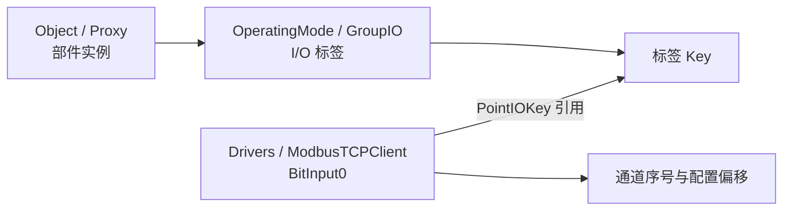

# Factory I/O 场景文件组织格式：Sorting by Height (Learn)

本阶段只理解保存文件的结构。用户已说明该场景与 CODESYS 的 Modbus 联机运行成功；本轮没有重复执行仿真，也没有修改场景或 PLC 工程。

分析对象：[Sorting by Height (Learn).factoryio](<F:/phd/project/digital-twin-factoryi-o/scenes/Sorting by Height (Learn).factoryio>)。结论基于这份文件、21 个安装目录中的官方场景，以及工作区另一个场景。这里描述的是观察到的保存格式，尚不是厂商提供的完整格式规范。

## 1. 文件外层是 XML

这份文件有 128,109 字节、1,253 行，开头是 UTF-8 BOM（`EF BB BF`），随后直接出现 `<FactoryIO ...>`，可用标准 XML 解析器读取。没有发现 ZIP 容器、XML 命名空间或 XSD 声明。

根节点属性包含：

| 字段 | 本文件值 | 可以确定的含义 |
| --- | --- | --- |
| `Type` | `MySavedScene` | 用户保存场景的类型标记；官方样本为 `PreBuiltSavedScene` |
| `Year` 至 `Second` | `2026-10-08 15:52:06` | 保存日期时间字段；文件没有编码时区 |
| `Version` | `2.5.8` | 保存文件的版本标记；官方对照文件标记为 `2.5.6` |
| `GUID` | 全零 UUID | 存在这一字段，但此样本不能用它唯一识别场景 |

顶层结构为：

```text
FactoryIO
├── Description                   场景说明
├── Camera                        6 个保存视角
│   └── CameraPosition
│       └── Data
│           ├── CameraPosition    相机位置
│           └── PivotPosition     观察中心
├── Object × 46                   场景对象实例，直接位于根节点下
│   ├── Proxy                     部件类型、对象 Key、空间配置
│   ├── ComponentIO               组件序号、工作模式、可选颜色
│   ├── OperatingMode             保存的工作模式 I/O 配置，部分对象没有
│   │   └── GroupIO
│   │       └── I/O 标签
│   └── 部件专用配置               Sensor / Emitter / Remover / Encoder 等
├── Instructor                    教学锁定配置
├── Drivers                       系统 Key 和 16 个驱动配置块
│   └── 某个驱动
│       ├── PointIOCount          各类通道的数量
│       ├── PointIOOffset         各类通道的偏移
│       ├── BitInput0 ...         通过 PointIOKey 引用标签
│       ├── BitOutput0 ...
│       ├── NumericOutput0 ...
│       └── Properties            驱动专用选项
└── Screenshot                    Base64 编码的 PNG
```

主文件中 `Camera` 起于第 3 行，首个 `Object` 起于第 41 行，`Instructor` 位于第 776 行，`Drivers` 起于第 777 行，`Screenshot` 位于第 1252 行。

## 2. Object：部件实例与空间配置

本文件有 **46 个 Object、22 种 PrefabName**。例如输送带、光电传感器、光幕、转台、按钮、显示器、出料器和围栏。22 个对象包含 OperatingMode/I/O 配置，另外 24 个没有该节点。

以入口光电传感器为例，其 `Proxy` 包含：

```xml
<Proxy PrefabName="DiffusePhotoelectricSensor"
       Key="b5a4210a-cf23-4ff4-b952-d643b443caa8">
  <Position X="294" Y="5" Z="145" />
  <Rotation X="0" Y="0.7071068" Z="0" W="0.7071068" />
  <FineRotation>0</FineRotation>
  <FinePosition>0</FinePosition>
  <Forward X="1" Y="0" Z="0" />
  <Up X="0" Y="1" Z="0" />
  <Right X="0" Y="0" Z="-1" />
</Proxy>
```

上面取自本文件的实际 Proxy 配置。这个 Key 标识的是对象；下面 I/O 部分的另一个 Key 标识它包含的入口信号标签。

| 字段 | 观察与解释 |
| --- | --- |
| `Object/@Locked` | 对象锁定标记；本文件全部为 False |
| `Object/@GroupKey` | 18 个围栏对象共享同一非零 Key，其余 28 个为全零；与编辑分组的解释一致 |
| `Proxy/@PrefabName` | 区分部件类别，例如 `Turntable`、`RollerConveyor6M`；引用内置部件的解释与文件内容一致 |
| `Proxy/@Key` | 本文件 46 个对象 Key 均唯一；它与 I/O 标签 Key 属于不同的实体 |
| `Position` | 保存 X/Y/Z；本文件对象位置都是整数，不能直接把数值认作米 |
| `Rotation` | 保存 X/Y/Z/W。按四元数解释后，与 Forward/Up/Right 一致，最大分量误差约 `3.36e-7` |
| `Forward/Up/Right` | 与旋转一致的三个方向向量 |
| `FinePosition/FineRotation` | 精细调整字段。本文件均为 0；其他官方样本有 0.025、0.05 的 FinePosition 和非零 FineRotation |

文件里没有看到部件网格、材质或碰撞模型的完整数据。它保存类型标识和实例配置，由软件解释这些标识的推断合理；具体内置资源注册表尚未检查。

2026-10-09 补充：本机 `XmlUtils.ReadVoxelObjectProxy`、`EditContext.CreateVoxelObject` 和 `Voxel.GetVoxelCenter` 已确认基础换算为 **`world = (grid + 0.5) * 0.125`**，逐轴应用。FinePosition 的应用方向、FineRotation 的完整应用和物理米制仍未校准。Camera 使用世界浮点坐标，不能直接与 Object 的整数网格 Position 混算。详见 [软件内部分析](factoryio-internal-automation.md)。

当前场景对象的 Up 为 `(0,1,0)`；结合输送带、传感器和光幕的位置，布局规划应按 XZ 水平面与 Y 高度组织。这里明确轴方向，仍未确定原始 Position 数值到世界长度的换算。进一步的构建顺序见 [场景构建步骤](factoryio-scene-construction.md)。

## 3. ComponentIO 与工作模式

`ComponentIO` 保存 `Index`、`CurrentOperatingMode`，部分部件另有 `Color`。

- `Index` 在不同 PrefabName 下重复，并非全场景唯一编号；多个不含 I/O 的对象为 `-1`。它是部件实例序号的解释有数据支持，但完整规则尚未确认。
- 工作模式名称保存为 `$C_..._NAME` 形式，形态类似软件本地化/资源标识。
- **CurrentOperatingMode 不能当成 XML 子节点索引。** 本文件的 DigitalDisplay 为 `CurrentOperatingMode="2"`，却只有一个 OperatingMode 节点，其说明为 `$C_DigitalDisplay_OM_Int_NAME`。LightCurtainEmitter 也有模式编号 1、仅一个保存的模式节点。

这说明工作模式编号与软件内置模式定义有关，当前 XML 不是所有可选模式的完整列表。后续若修改模式，应先取得相应模式的保存样本。

## 4. I/O 标签：名称、地址、身份和覆盖配置

本文件包含 **24 个 BinaryInput、16 个 BinaryOutput、1 个 IntOutput，共 41 个对象标签**，Key 均唯一。这里的 Input/Output 使用控制器视角：Input 是 PLC 获取的信号，Output 是 PLC 发出的命令。

实际入口标签位于 [原文件第 113 行](<F:/phd/project/digital-twin-factoryi-o/scenes/Sorting by Height (Learn).factoryio:113>)：

```xml
<BinaryInput Name="At entry" Address="4"
             Key="51422566-6f6a-4d0c-b83b-ed6dd4d766f5"
             OpenCircuit="False" ShortCircuit="False"
             UseForcedValue="False" ForcedValue="False" />
```

| 字段 | 作用 |
| --- | --- |
| `Name` | 标签显示名称；本文件有多个名称为 `-` 的光幕标签，名称不能作为唯一身份 |
| `Address` | 场景标签地址字段；不能直接当作当前驱动的 Modbus 地址 |
| `Key` | 标签身份，驱动通过它建立引用关系 |
| `OpenCircuit/ShortCircuit` | 文件保存的故障标记；具体运行效果仍由软件实现 |
| `UseForcedValue` | 是否启用强制值 |
| `ForcedValue` | 保存的强制值，BOOL 或数值；它不是普通实时值 |

本文件的 Emitter、Remover right、Remover left 均为 `UseForcedValue=True`、`ForcedValue=True`，并未映射到 Modbus Client。相反，Left conveyor 虽保存 `ForcedValue=True`，但 `UseForcedValue=False`，不能据此判断它正在运行。

其他场景的模拟量标签实际使用 `AnalogueInput/AnalogueOutput`，而相应驱动通道可以叫 `FloatInputN/FloatOutputN` 或 `NumericInputN/NumericOutputN`。标签类型名与通道类型名要分开识别。

## 5. Drivers：通过 Key 连接场景标签与协议通道

最关键的关联是：



以入口信号为例：

```xml
<!-- 对象里的标签 -->
<BinaryInput Name="At entry" Address="4"
             Key="51422566-6f6a-4d0c-b83b-ed6dd4d766f5" />

<!-- ModbusTCPClient 里的通道 -->
<BitInput0 PointIOKey="51422566-6f6a-4d0c-b83b-ed6dd4d766f5" />
```

入口标签的场景 Address 是 **4**，驱动槽位却是 **BitInput0**。同样，Low box 的场景 Address 是 26、驱动槽位是 BitInput1；Green indicator 的场景 Address 是 13、驱动槽位是 BitOutput7。关联依据是 Key，不是地址相等。

Modbus Client 配置位于 [原文件第 1031 行](<F:/phd/project/digital-twin-factoryi-o/scenes/Sorting by Height (Learn).factoryio:1031>)，包含：

- BitInputCount = 17、BitOutputCount = 13、NumericOutputCount = 1。
- 这些通道的 Offset 都是 0。
- Properties 为 `ReadCoils=False`、`ReadHoldingRegisters=False`、`ScaleFactor=100`。
- 共 31 条映射：30 条对象标签引用，加 1 条系统 Key 引用。

本文件同时保存 ModbusTCPClient、ModbusTCPServer、Siemens、Allen-Bradley 等共 16 个驱动块。块存在只说明有保存配置。`Drivers/@CurrentDriver` 为 0；此枚举的具体含义尚未确认，不能据此断言当前运行时使用哪个协议。

**ModbusTCPClient 块没有 IP、Port 或 Slave ID。** 这些连接参数无法仅从这份场景文件重建。驱动槽位、Offset、数据区选择和目标 PLC 配置需要一起解释；NumericOutput0 也不能单凭名称认定为一个 16 位寄存器。

### 本文件的完整 Modbus Client 映射

| 驱动槽位 | 对象标签或系统字段 | 场景标签 Address |
| --- | --- | --- |
| BitInput0 | At entry | 4 |
| BitInput1 | Low box | 26 |
| BitInput2 | High box | 24 |
| BitInput3 | At turntable entry | 5 |
| BitInput4 | At load position | 0 |
| BitInput5 | At unload position | 1 |
| BitInput6 | At front | 2 |
| BitInput7 | At right entry | 6 |
| BitInput8 | At left entry | 7 |
| BitInput9 | At right exit | 9 |
| BitInput10 | At left exit | 8 |
| BitInput11 | Start | 16 |
| BitInput12 | Reset | 17 |
| BitInput13 | Stop | 18 |
| BitInput14 | Emergency stop | 19 |
| BitInput15 | Auto | 11 |
| BitInput16 | 系统字段 RunInputKey | 不在 Object 中 |
| BitOutput0 | Feeder conveyor | 0 |
| BitOutput1 | Entry conveyor | 1 |
| BitOutput2 | Load | 2 |
| BitOutput3 | Unload | 3 |
| BitOutput4 | Turn | 4 |
| BitOutput5 | Left conveyor | 5 |
| BitOutput6 | Right conveyor | 6 |
| BitOutput7 | Green indicator | 13 |
| BitOutput8 | Yellow indicator | 12 |
| BitOutput9 | Red indicator | 11 |
| BitOutput10 | Start light | 8 |
| BitOutput11 | Reset light | 9 |
| BitOutput12 | Stop light | 10 |
| NumericOutput0 | Counter（IntOutput） | 0 |

这里的系统字段来自 Drivers 根节点的 Key 属性。该根节点还有 PauseInputKey、ResetInputKey、TimeScaleInputKey、RunOutputKey、PauseOutputKey、ResetOutputKey 和 CameraIndexOutputKey。解析器需要把它们与对象标签一起作为可引用目标，不能把未在 Object 中找到的系统 Key 一律视为坏引用。

未映射到本文件 Modbus Client 的对象标签有 11 个：6 个名称为 `-` 的光幕位、At back、Manual，以及 3 个强制开启的 Emitter/Remover 标签。41 个对象标签与 31 个驱动通道不是同一个计数。

## 6. 部件专用设置和附属数据

- **Sensor**：6 个光电传感器的 Range 字段均为 0.8。
- **Emitter**：MinTimeToEmit 与 MaxTimeToEmit 均为 4，另外有 UpTo、随机位置/朝向开关；Bases/Parts 节点保存允许的物料类型布尔开关。
- **Remover**：有两套 Bases/Parts 类型过滤配置。
- **Encoder**：4 个输送带对象包含 Encoder 节点，本文件 Enabled 都为 False。
- **Camera**：保存 Camera 1–4、Electric Board、Current 六个视角，包含位置与观察中心。
- **Instructor**：密码为空，LockCurrentParts、RunModeOnly、HideFailures 均为 False。
- **Screenshot**：Data 为 52,836 字符的 Base64，解码为 39,625 字节的 PNG，分辨率 192×108；已经无修改地提取到 `artifacts/factoryio-format/thumbnail.png`。

在这份文件中未发现 PLC 的 ST 源代码、GVL 变量定义、循环任务配置或 PLC 内存状态，也未发现运行中物料的完整动态状态。这份文件承担的是场景配置与驱动映射的保存职责。

## 7. Learn 与官方 Advanced 的关系

与安装目录中的 `Sorting by Height (Advanced).factoryio` 做 XML 元素树对比，忽略排版空白和属性顺序、保留子节点顺序，发现 **8 处差异**：

- 7 个根属性：Type、Version、Year、Month、Day、Minute、Second。
- Screenshot 的 Data。

**Description、Camera、46 个 Object、Instructor、Drivers 的配置完全一致。** 因而这份 Learn 文件在场景配置层面是官方 Advanced 场景的再次保存版本；尚不能据此推断软件内部如何实现版本迁移。

也已读取用户指出的本地 CODESYS 教程正文。该教程明确使用 Sorting by Height (Advanced)，在 CODESYS 中另建 GVL/PLC_PRG；这与“场景配置保存在 .factoryio，控制程序保存在 CODESYS 工程”的文件分工一致。本阶段没有复制或改写该控制程序。

## 8. 已验证范围与尚未确定的部分

已验证：

1. 主文件可以解析为 XML，41 个对象标签 Key 和 46 个对象 Key 无重复。
2. 主文件所有驱动 PointIOKey 都能解析到对象标签或系统 Key。
3. 21 个官方场景和 2 个工作区场景，共 23 份文件均可解析；这些文件的所有驱动 Key 引用均可解析，无重复对象或标签 Key。
4. 主文件相对官方 Advanced 的结构差异仅限上述 8 处。
5. 主文件分析前后的 SHA-256 相同：`04da4aaaacbb3e5e0adedba912df75dbaab6aaa157a25e80aac48268d22de59c`。

尚未确定：部件类型的完整运行时目录、精细位置/旋转与物理单位的完整换算、各枚举值的语义、连接参数的实际存储位置，以及程序化修改/新增对象后软件能否正常加载。基础网格到引擎坐标换算已由 2026-10-09 软件内部分析补充；当前解析结果不等于编辑后导入验证通过。

下一项针对文件格式的验证可以在工作副本中仅移动一个对象、仅修改一个标签名，分别由 Factory I/O 保存后对比 XML，从而校准空间字段和身份稳定性。本轮尚未执行这些修改。

## 9. 可复查的解析产物

只读工具：[inspect_factoryio.py](F:/phd/project/digital-twin-factoryi-o/tools/inspect_factoryio.py)。仅使用 Python 标准库，读取源文件，输出 JSON/CSV 和原始缩略图；不提供场景写回功能。

在项目目录运行：

```powershell
python .\tools\inspect_factoryio.py '.\scenes\Sorting by Height (Learn).factoryio' --compare 'E:\Program Files (x86)\factory\Scenes\Sorting by Height (Advanced).factoryio' --corpus 'E:\Program Files (x86)\factory\Scenes' --corpus '.\scenes' --output-dir '.\artifacts\factoryio-format'
```

输出：

- `inspection.json`：完整对象配置、标签、系统 Key、驱动映射、字段名清单、源文件行号与 SHA-256。
- `modbus-client-mapping.csv`：31 条 Modbus Client 映射，包含标签地址与驱动序号，便于分别检查。
- `comparison.json`：与官方 Advanced 的 8 处差异。
- `corpus-summary.json`：23 个本地场景的结构与引用检查结果。
- `thumbnail.png`：原文件内嵌 PNG 的直接解码结果。
