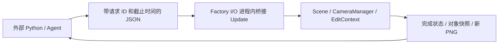

# Factory I/O 软件内部调用与桥接原型

2026-10-09：针对本机安装进行只读程序集分析，再编译项目自己的桥接 DLL。桥接已在 Factory I/O 2.5.8 的实际进程中初始化，自动加载、再次加载、截图、相机切换及工作流 hook 已通过。对象增删/原生保存仍仅完成调用路径定位，PLC 通信和实际分流尚未验收。

## 已确认的内部结构

安装目录为 `E:\Program Files (x86)\factory`。`Factory IO_Data/Managed` 包含 Unity/Mono 的托管程序集，核心业务在 `Assembly-CSharp.dll`，Console 依赖 IronPython。已复制 159 个 DLL 到 `artifacts/software-analysis-001/managed-copy`，用 [ILSpy](https://github.com/icsharpcode/ILSpy) 11.1.0.9782 对相关类型做选择性反编译。分析、编译均针对副本，原安装文件哈希在结束时复核。

本次核心程序集 SHA256：`1fc9429d6ddb2ac6f2285e8ab43f5116a26b03e06dfd33a5f6a1a5345636f2ff`。这些内部类型不是官方承诺稳定的 SDK，结论和原型只绑定本次检查版本。

| 功能 | 本机代码中实际找到的路径 |
| --- | --- |
| Console 执行 | `Scripting.OnCommandLineInserted` → `ExecuteStatement` → IronPython 的 `SingleStatement` 与共享 scope |
| 文件配置执行 | `Config.LoadCfg` 逐行调用 `Scripting.ExecuteStatement` |
| 场景加载 | `SceneProxy.load_from_path` → 未保存检查 → `Scene.Load` → 下一帧 `ExecuteLoad` → `CurrentSceneInfo` |
| 截图 | `SceneProxy.capture_screenshot` → `Scene.CaptureScreenshot` → Unity `ScreenCapture.CaptureScreenshot` |
| 相机切换 | `CameraProxy.position_index` → `CameraManager.CameraPositionIndex` → `LoadPosition` |
| 部件放置 | `PlaceAtPosCommand` → `CommandHolder` 队列 → `EditContext.CreateVoxelObject` |
| 对象读取 | `EditContext.GetAllVoxelObjectsProxies`，包含 Key、PrefabName、网格坐标、旋转和微调 |
| 软件原生保存 | `Scene.Save` → `EditContext.Serialize` → `XmlUtils.WriteVoxelObjectProxy` |

核心发现：DLL 内有 `SceneApiController` 和 `PartApiController`，包括 `/mode` 与 `/parts/place` 等路由，但本机 `FioWebServer.CreateWebServer` 只注册了 `TagApiController`。只读实测 `/api/tags` 返回 8 个系统标签，`/api/mode`、`/api/paused` 均为 HTTP 404。因此不能直接把这些内部控制器的路由当作当前可用 HTTP 接口。未发送部件创建请求，也未修改服务器注册逻辑。

另一个发现是 Console 的确使用 IronPython 实现，但启动代码移除了内置 `__import__`；它不是一个外部 Python 模块。桥接引导没有恢复 import，而是使用现有 CLR 对象的类型信息加载项目 DLL。隔离测试后，用户在已有场景执行一次 `execfile` 引导，实际组件安装与后续外部请求均成功。

## 为什么先做进程内桥接

Unity 对象和引擎 API 必须在其实际进程的适当线程中调用。在外部 Python/C# 进程中加载 `Assembly-CSharp.dll`，不会获得正在运行的场景对象。原型采用本机文件 IPC，由 Unity `MonoBehaviour.Update` 执行请求：



源代码：`tools/factoryio_bridge/AgentBridge.cs`、`client.py`、`build.py`、`probe-bootstrap.ps1`。目前支持 `status`、`prefabs`、`load`、`capture`、`camera` 五种请求，不暴露任意 Console 执行、PLC 控制或对象增删。

- 初始化时核对实际安装的核心 DLL 文件哈希；组件挂载在已有 Scripting 对象上。
- 外部请求原子落盘，使用 UUID 和截止时间；软件在主线程串行处理。
- 加载先核对源文件 SHA，遇到未保存场景拒绝执行。等待 `IsLoading=false`、`CurrentSceneInfo` 路径一致、帧间隔和源文件 SHA 后返回对象快照。
- 截图使用新的请求 ID 文件名；等待新 PNG 落盘、完整结束标记和连续帧长度稳定后计算 SHA。原型限制倍率为 1–4。
- 相机请求检查已保存视角范围；返回表示位置选择已执行，不等于视角动画已经稳定。
- 客户端拒绝请求 ID 不匹配、图像越界或 SHA 不一致的响应。桥接未初始化或超时都返回失败。

这些检查已获得本机 Unity 运行证据。文件落盘检查仍不替代 Agent3 对实际画面的审查。`workflow_hook.py` 已接入本机 `config.local.json` 的 `load_command`、`capture_command`，并通过实际加载回执及 `collect_evidence` 调用。回执核对工作流 nonce、源文件 SHA、完成路径、对象快照和加载期间请求文件不变；截图生成新 PNG，并保存原始桥接响应。

## 编译与隔离验证

已用本机已有 .NET Framework C# 编译器，引用 Factory I/O 副本中的真实程序集，编译得到：

`artifacts/software-analysis-001/bridge-build-02/FactoryIOAgentBridge.dll`

结果为 exit code 0，编译器无错误或警告输出。报告：同目录 `compile-report.json`。

使用 Windows PowerShell/.NET Framework 创建独立 IronPython 引擎，按软件逻辑移除 import，并用不调用构造函数的真实 `SceneProxy` 类型验证 `execfile` → DLL 加载 → `Bootstrap.Protocol`。结果：协议为 `factoryio-agent-file-bridge/1`，import 仍不可用，`unity_install_invoked=false`。报告：同目录 `bootstrap-probe.json`。这只验证了引导表达式的语言与 CLR 兼容性。

Python IPC 的 5 项失败条件测试通过，覆盖缺少桥接、超时、串错请求、图像被改动和输出路径越界。没有把这些离线测试当作场景运行证据。

可复现的准备命令，在项目根目录执行：

```powershell
& .\.venv\Scripts\python.exe tools\factoryio_bridge\build.py --managed-copy artifacts\software-analysis-001\managed-copy --out artifacts\software-analysis-001\bridge-build-new --ipc artifacts\software-analysis-001\ipc-new
powershell.exe -NoProfile -File tools\factoryio_bridge\probe-bootstrap.ps1 -ManagedCopy artifacts\software-analysis-001\managed-copy -BridgeDll artifacts\software-analysis-001\bridge-build-new\FactoryIOAgentBridge.dll -Report artifacts\software-analysis-001\bridge-build-new\bootstrap-probe.json -ProbeCfg artifacts\software-analysis-001\bridge-build-new\probe-only.cfg
& .\.venv\Scripts\python.exe -m unittest discover -s tests -p test_factoryio_bridge_client.py -v
```

`build.py` 只生成 DLL、报告和候选 `bootstrap.cfg`，不安装配置或重启软件。输出目录需用新名称。

## 下一步的最小联机验收

先在实际 Factory I/O 进程中进行一次引导，然后从外部代码请求状态和截图。本次用户已在打开的高度场景执行下面的 Console 语句，组件随后在原 PID 40048 初始化：

```python
execfile(r"F:\phd\project\digital-twin-factoryi-o\artifacts\software-analysis-001\bridge-build-02\bootstrap.cfg")
```

这会在进程内加载项目桥接 DLL，创建主线程处理组件与 IPC 目录。随后外部 Python 代码才可调用：

```powershell
& .\.venv\Scripts\python.exe tools\factoryio_bridge\client.py --ipc artifacts\software-analysis-001\ipc status
& .\.venv\Scripts\python.exe tools\factoryio_bridge\client.py --ipc artifacts\software-analysis-001\ipc capture --size 1
```

2026-10-09 初次尝试：窗口控制首次返回 `failed to activate captured window`，重新选择当前窗口后返回 `FrameArrived timed out: timed out waiting on channel`。已停止界面输入，没有盲输 Console 命令。当时桥接未初始化，失败记录保存在 `artifacts/bridge-live-validation-001/verification-report.json`。随后用户完成一次 Console 引导，后续场景导入全部由代码执行；失败报告保留为历史证据。

准备好的实机验证入口会保留当前截图，然后加载指定 manifest 对应的场景，核对文件 SHA、对象 Key/prefab/整数网格/四元数/精细位置和旋转、I/O 标签，并截取加载后的新 PNG。任一步失败都写入报告，不能产生通过记录。输出目录必须新建；加载遇到未保存编辑仍拒绝执行。

```powershell
& .\.venv\Scripts\python.exe tools\factoryio_bridge\verify_live.py --ipc artifacts\software-analysis-001\ipc --manifest artifacts\agent-demo-02\scene-001\manifest.json --io-contract artifacts\agent-demo-02\scene-001\io-contract.json --out artifacts\bridge-live-validation-new
```

自动检查通过也不代表完整视觉审查或实际重量分拣通过，报告保留这两个独立验收项。最终全部 114 项 Python 测试通过；实际进程证据保存在 `artifacts/bridge-live-validation-003`。

验收顺序为：真实状态响应 → 当前画面 PNG 与 SHA → 已保存相机切换 → 测试场景加载与再次加载 → 对象/标签/画面核对。本机已完成上述自动检查并连接工作流 hook，写入 `C:/Users/tongqingwang/Documents/Factory IO/auto.cfg` 的桥接引导。该配置仅在软件启动时执行；当前进程没有重启，完整重启后的自动初始化仍待验证。没有修改原安装 DLL 或许可配置。

## 连续加载发现的格式要求

首次加载生成场景成功，但再次加载时原生 `Scene.CheckSceneChanged` 抛出 NullReferenceException。代码定位到 `Scene.GetSceneData`：它从 XML 中移除 `Screenshot`、`Camera`、`Description`，没有检查缺失节点。生成器此前为了避免旧缩略图误导而删除 Screenshot，导致这个后续检查失败。

修复方式是清空旧缩略图数据并保留 `<Screenshot Data="" />`，同时补齐缺少的 Camera/Description。空缩略图是文件元数据，占位图不作为当前场景视觉证据。当前画面来自新的进程内截图。

已用元数据补充作为实际对照实验：短暂补充当前旧生成文件的空 Screenshot 后，原生检查与新场景加载立即成功；随后恢复旧文件的原始字节和 SHA。新生成版本连续加载和工作流 hook 均通过。报告：`bridge-live-validation-003/recovery/recovery-report.json`、`verification/verification-report.json`、`workflow-hooks/hook-verification.json`。修复没有跳过原生未保存检查。

当前加载的修复版本：`artifacts/bridge-live-validation-003/scene-fixed/scene.factoryio`，SHA256 `9b138286b687242f3d126ae3728a59cf102419f17a030c805d5ef75aed52ccd9`。56 个对象（含精细偏移）和 44 个标签均匹配；桥接枚举 97 个 prefab 名称。相机 0、4 的新截图可观察视角变化。当前画面仍为编辑状态、驱动 None；这些成功不能证明 Modbus 控制或物料分流已运行。

## 对 `.factoryio` 格式理解的补充

`XmlUtils.ReadVoxelObjectProxy` 把 XML `Position` 读成 `Vector3Int`；`EditContext.CreateVoxelObject` 通过 `Voxel.GetVoxelCenter` 实例化对象。基础坐标换算已经从代码确认：

`world = (grid + 0.5) * 0.125`，逐轴应用；反向为 `grid = floor(world / 0.125)`。

因此文件对象的整数网格位置和相机/引擎世界坐标不能直接混用。这里的 0.125 是引擎坐标单位；物理米制和 FinePosition/FineRotation 的完整应用仍需进一步校准。普通 `PlaceAtPosCommand` 会把四元数吸附到 24 种正交旋转之一，精细旋转属于另一层设置。

后续 Agent1 可经桥接读取真实 prefab 清单，Agent2 可逐步引入原生对象创建/撤销/保存，Agent3 获得运行中的新截图。当前部件放置只完成代码定位，没有执行或接入这些写操作。

## 保存后完整重启与 Modbus 联机

2026-10-09 用户保存场景后，Factory I/O 已完整重启；auto.cfg 自动初始化 bridge-build-03，当前 IPC 根目录为 `artifacts/software-analysis-001/ipc-03`。新版桥接增加 `connect_modbus`，限定当前驱动为 ModbusTCPClient，并连接本机 127.0.0.1:502 / Unit ID 1；status 读回实际驱动与连接状态。CLI 可执行：

```powershell
& .\.venv\Scripts\python.exe tools\factoryio_bridge\client.py --ipc artifacts\software-analysis-001\ipc-03 status
& .\.venv\Scripts\python.exe tools\factoryio_bridge\client.py --ipc artifacts\software-analysis-001\ipc-03 connect_modbus
```

001 调试场景为 `artifacts/weight-live-start-001/scene.factoryio`，加载驱动字段为 64。PLC 下载期间连接会中断；后续重新连接恢复输送时，旧通知仍可能保留。Run API 回执不能证明编辑模式或通知关闭已经生效，应读 Running 并检查当前截图。当前 002 版在下载完成后重启本轮生成场景，旧通知已消失；未将其泛化为丢弃用户未保存编辑的处理方式。

已观察到实际物料称重、前方和右侧分流与出口计数递增；桥接自身不代替 PLC 扫描或输出控制。运行记录见 [重量控制联机调试](weight-baseline-runbook.md)。
