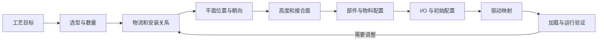

# Factory I/O：从工业需求到可运行场景的拆解

本文将“选 Object，再确定组织与摆放”扩展为场景构建流程。当前讨论 Factory I/O 场景部分，不生成 PLC 程序，不修改已有场景。

依据：当前 `Sorting by Height (Learn).factoryio` 的实际 XML，以及官方场景编辑、传感器和物料生成文档。流程顺序是本项目的建议；坐标单位、部件安装基点、枚举值仍需分别校准。

## 1. 坐标约定：先平面，再高度

用户提出的“先规划平面，再确定高度”的拆分成立。落实到当前保存文件的世界坐标，应使用 **XZ 水平面，Y 高度**。

依据是当前场景这些对象的 `Up=(0,1,0)`，以及设备和传感器的实际位置与方向：

| 对象 | X | Y | Z | 本场景中的相对关系 |
| --- | --- | --- | --- | --- |
| Feeder conveyor | 302 | 2 | 141 | 沿 X 方向接到入口段 |
| Entry conveyor | 271 | 2 | 141 | 与进料段、转台处于同一高度和 Z 位置 |
| Turntable | 239 | 2 | 141 | 位于两条出口线之间 |
| Left conveyor | 239 | 2 | 117 | 沿 Z 负方向延伸 |
| Right conveyor | 239 | 2 | 165 | 沿 Z 正方向延伸 |
| At entry 传感器 | 294 | 5 | 145 | Y 高于输送带对象基点 |
| 光幕发射端 | 287 | 9 | 136 | 与接收端同 X、同 Y |
| 光幕接收端 | 287 | 9 | 146 | 与发射端在 Z 方向分开 |

以上均为文件原始数值，不能未经校准直接当作米。对象 Position 表示的是保存的放置基点，也不能直接当作输送面高度或几何中心。

机械设备自身动作轴的 X/Y/Z 标签需要按该部件定义解释；不要直接等同于 Proxy/Position 的世界坐标轴。

## 2. 推荐的构建步骤

| 步骤 | 需要确定什么 | 产物与对应文件字段 |
| --- | --- | --- |
| 0. 定义工艺目标 | 处理什么物料、经过哪些环节、什么结果算完成 | 工艺说明、逻辑流程；Description 可保存简述 |
| 1. 选择 Object | 部件类型、数量、用途和基本工作模式 | Object、Proxy/PrefabName、ComponentIO |
| 2. 定义组织关系 | 上下游传递、出口分支、安装关系、成对设备关系 | 关系规划；当前 XML 主要通过布置与部件行为实现这些关系 |
| 3. 规划空间布局 | 水平位置、朝向、高度、安装与传递面的对齐 | Position、Rotation、Forward/Up/Right、FinePosition/FineRotation |
| 4. 配置部件行为 | 工作模式、检测范围、可用信号、部件专用参数 | ComponentIO、OperatingMode、Sensor、Encoder 等 |
| 5. 配置物料输入输出 | 生成什么物料、何时生成、生成数量、从何处回收 | Emitter、Remover、Bases、Parts |
| 6. 定义 I/O 与初始配置 | 信号名称、类型、Key、强制值和故障配置 | GroupIO、BinaryInput/Output、AnalogueInput/Output、IntInput/Output |
| 7. 配置驱动映射 | 使用哪个协议、各通道对应哪个信号、数量与偏移 | Drivers、PointIOCount、PointIOOffset、PointIOKey、Properties |
| 8. 完善观察与保存信息 | 视角、分组、锁定、说明、缩略图和保存标记 | Camera、GroupKey、Locked、Instructor、Description、Screenshot、根属性 |

实际连续加载验证补充：不能为了清除旧缩略图而删除 Screenshot 节点。本机 2.5.8 的未保存修改检查要求 Screenshot、Camera、Description 节点存在。生成器保留 `<Screenshot Data="" />` 作为占位，当前画面另从软件截图获取；首次加载成功后，还需验证再次加载，才能支持 Agent2 的修复循环。
| 9. 验证场景 | 文件引用、物理布置、传感器检测、物料运输与通信是否成立 | 检查结果、运行记录 |

这是可以逐项验收的顺序；部件选型、工作模式和安装高度相互影响，允许回到前面的步骤调整。



## 3. 先确定关系，再求坐标

Object 的组织至少有三个方面：

- **物流关系**：A 的输出进入 B 的哪个入口，分流后分别到哪里。
- **安装与检测关系**：某个传感器监测哪个工位或哪段输送带，光幕发射端与哪个接收端配对。
- **空间关系**：通过位置和朝向使上述关系在物理场景中成立。

以现有场景的结构为例，拟讨论的物流路线可以画为：

```text
Emitter → Feeder conveyor → Entry conveyor → Turntable
                                              ├→ Left conveyor → Remover left
                                              └→ Right conveyor → Remover right
```

这描述路径结构。高低箱具体走哪个出口、控制程序实际采用什么分流规则，需要在工艺目标和控制逻辑中明确；场景文件里的部件摆放本身不足以确定控制策略。

当前 XML 没有显式的物流边列表。GroupKey 用于编辑分组，也没有编码“物料从 A 传到 B”的完整关系。为了后续稳定生成场景，关系规划应作为独立的设计信息保留。

## 4. 摆放应拆成位置、朝向、高度和接合约束

### 4.1 水平布局：XZ 与朝向一起规划

确定每个部件的平面占地、位置、进出料方向和通道间距。转动长输送带会改变占地和连接位置，因此朝向要参与布局计算。

当前场景里：

- 进料段、入口段、转台的 Forward 为 `(-1,0,0)`。
- Left conveyor 的 Forward 为 `(0,0,-1)`。
- Right conveyor 的 Forward 为 `(0,0,1)`。

这些是保存的部件方向；具体命令下的运动方向还要结合工作模式和部件箭头检查。官方建场景教程要求先旋转两侧输送带再与转台配合，部件箭头可用于判断物料流向。[官方建场景教程](https://docs.factoryio.com/getting-started/creating-a-scene/)

### 4.2 高度：Y 与物料接合面一起调整

核对承载面是否能交接物料、出料器是否把物料放在输送带上、传感器能否覆盖物料、回收器能否覆盖出口。不同型号的对象基点可能不同，应对齐需要接合的工作面。

传感器高度应由检测目标决定。例如检测物料存在、区分高度和确认机械限位，需要的安装位置不同。

### 4.3 成对设备与碰撞约束

检查发射/接收设备的相对位置和朝向、运动部件的活动空间、物料可能经过的间隙。官方光幕说明要求发射与接收端正确对齐，并以指示灯确认同步；匹配两端高度只是其中一个条件。[官方传感器说明](https://docs.factoryio.com/manual/parts/sensors/)

传感器或光幕的检测方向还要结合该 Prefab 的实际检测面确认，不能仅凭 Forward 字段认定光束一定沿这个轴发出。

官方编辑器会检查非法相交布置。因此文件能解析后，仍需在 Factory I/O 中检查布置有效性。[官方编辑说明](https://docs.factoryio.com/manual/edit-and-run/)

### 4.4 支持布局规划的部件信息

除 PrefabName，还需要逐步确认每种部件的尺寸与占地、放置基点、允许旋转方式、进出料面、运动空间、工作模式和 I/O 定义。当前 .factoryio 保存的是实例配置，未提供这些信息的完整部件目录。

## 5. 工作模式和物料配置决定场景行为

同一个部件类型可能具有不同的控制接口。选型时先确定基本工作模式，再核对它保存的标签集合。以光幕为例，官方支持数字、数值和模拟量模式，三者的 I/O 组织不同。[光幕配置](https://docs.factoryio.com/manual/parts/sensors/#light-array-emitter-and-receiver)

物料也需要单独配置：

- 物料种类与尺寸类别，是否带托盘或底座。
- 生成间隔、数量及随机位置/朝向。
- 生成和回收区域的位置，允许回收哪些类型。
- Emitter/Remover 是由 PLC 控制还是使用明确的强制配置。

当前文件的 Emitter 保存 MinTimeToEmit=4、MaxTimeToEmit=4，且随机位置和朝向均关闭。官方说明最小/最大时间相等时采用固定生成间隔；后续修改这些值会改变场景输入节奏。[Emitter 文档](https://docs.factoryio.com/manual/parts/emitter/)

## 6. I/O 定义、初始配置与协议映射

先列出需要观测和控制的信号，确定输入/输出、类型、物理含义和名称，然后维护标签 Key。部件工作模式改变时，需要重新检查标签集合。

初始配置需明确哪些强制值启用、哪些故障标记启用。当前场景的 Emitter 和两个 Remover 都强制为 True，而三个标签没有映射到 Modbus Client；这也是场景能够持续进料、回收的一部分配置。

协议映射再通过 PointIOKey 将槽位连接到标签。例如入口标签 Address=4，却映射到 BitInput0。场景 Address 与驱动槽位应分别记录。

驱动还需要目标 IP、端口、Unit ID 等环境配置。当前场景的 ModbusTCPClient 块没有保存这些参数，后续复现时需要另行记录连接设置。

## 7. 验证分成可分别完成的检查

1. **文件检查**：XML 可读、对象和标签身份无冲突、驱动引用可解析。
2. **布置检查**：所需部件存在、安装关系正确、工作面能接合、检测区域有效。
3. **物理运行检查**：受控地逐个启用执行器，检查单件物料能否运输、检测和回收，并恢复初态。
4. **通信检查**：场景信号与控制器变量一致，执行器命令能传到对应对象。
5. **工艺检查**：按照事先约定的输入和输出规则验证完整行为。

用户已说明当前场景联机运行成功。本轮仅补充构建流程和字段拆解，没有重复执行这些运行检查。
