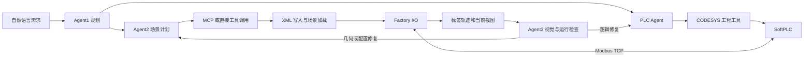

# Factory I/O 与 CODESYS MCP 评估

检查日期：2026-10-09。本地测试证据与项目作者声称的测试范围分别记录。

## 结论与选择

CODESYS 已有官方 MCP，可以用于 PLC Agent 的工程浏览、代码编辑和工程操作。Factory I/O 本轮未找到可验证的官方专用 MCP；适合把官方 Web API、场景 XML 生成器和独立加载/截图入口包装成项目自己的 MCP。

| 路线 | 依据与要求 | 对本项目的用途 | 本机验证 |
| --- | --- | --- | --- |
| [官方 CODESYS MCP Server](https://store.codesys.com/en/codesys-mcp-server.html) | 官方列出 V3.5.22.1+；详细兼容表从 3.5.22.10 起；需要 Professional Developer Edition 订阅 | 优先评估的长期工程接口，具体工具覆盖需安装后检查 | 本机 3.5.22.30 满足版本范围；未安装或验证 MCP 许可 |
| [mcptoolkit-for-codesys](https://github.com/zbest1000/mcptoolkit-for-codesys) | MIT、Python MCP + CODESYS ScriptEngine + 文件 IPC；作者主要验证 SP22 Patch 1 | 备选 PLC 工程操作服务，可浏览 POU/GVL、编译、配置任务/设备、在线操作 | v0.2.2 / commit `0fcadf89395fe312099a32e23bb32c1f2cb7edd8`；实际 initialize、tools/list 返回 82 个工具；未验证其工程编辑、编译或下载 |
| [codesys-mcp-toolkit](https://github.com/johannesPettersson80/codesys-mcp-toolkit) | MIT、Node MCP + 每次独立 ScriptEngine 进程 | 可选工程浏览/POU 编辑，缺少设备/任务配置及下载启动 | 固定提交 `1195a6724017b831b4f2e24d15541dbdc57429b7`；8 工具握手、POU 创建、重量 ST 写入/读取成功；发现部分更新清空声明、错误编译仍返回成功，见[本机验证](johannes-codesys-mcp-validation.md) |
| 本项目 `factoryio_agents.mcp_server` | 官方 MCP Python SDK，包装本项目工具 | 场景模板/生成、标签采集、完整 ST/GVL 写入编译、Runtime 服务与只读在线探测 | 2026-10-09 实际 9 工具；codesys_compile_program 正例 0 错误、0 警告、30 绑定及任务匹配，负例返回 2 个真实错误；管理员启动 Runtime 后 Modbus 读取成功，更新设备凭据后 codesys_online_probe 实际登录成功并读到应用 Stop；早期 tags 的 8 标签结果是当时场景快照 |

开源 CODESYS 服务已安装到项目 `.venv`，源代码保留于 `artifacts/mcp-research/mcptoolkit-for-codesys/`。没有把它注册为 Codex 的全局 MCP，也未让它连接或修改当前 IDE。发现其具名 Application 选择分支使用 `set_active_application`；该方法在本机 SP22 Patch 3 的实际 ScriptProject 上不存在，因此工具列表可用不能证明所有工程操作兼容。

[NPavii/codesys-mcp-server](https://github.com/NPavii/codesys-mcp-server) 和 [luke-harriman/Codesys-MCP](https://github.com/luke-harriman/Codesys-MCP) 也提供相关实现，本轮未做本机安装或调用。`go-factory-io` 的 SECS/GEM MCP 与 Real Games 的 Factory I/O 仿真软件不是同一个产品。

## Factory I/O 能封装的接口

[官方 Web API](https://docs.factoryio.com/manual/web-api/) 要求 Ultimate Edition，并开启 `app.web_server = True`，默认端口 7410。支持标签清单、值读取与输出写入。本机只读调用已成功；项目默认不通过此接口覆盖 PLC 的执行器输出。

[官方 Console](https://docs.factoryio.com/manual/console/) 有 `scene.load_from_path(string scene_path)`、`scene.capture_screenshot(string file_name, bool hide_console)` 和标签/映射导出命令。但 Console 命令存在并不等于具有可直接远程调用的 HTTP 端点。截图默认保存到 Documents 中的 FactoryIO/Screenshots。当前加载/截图 hook 已在 Factory I/O 2.5.8 实测并配置，不能把旧场景缩略图当作当前画面。

[官方 SDK](https://docs.factoryio.com/manual/sdk/) 面向仿真 I/O。本轮查到的接口没有证明能够通过通用 CRUD 创建并摆放所有三维部件。Agent2 的场景生成仍由确定的 `.factoryio` XML 写入器完成，随后必须导入软件验证。

2026-10-09 补充：已下载官方 SDK 固定提交并反射检查 `Engine IO.dll` 的公开接口，未找到场景加载、截图或 Console 执行方法。相机和运行状态可经系统标签控制；Console 支持 `auto.cfg` 启动执行。官方 C# 还包含重量分拣示例。详细边界、启动候选和本机证据见 [SDK 与 Console 自动化核查](factoryio-sdk-automation.md)，启动脚本尚未执行验收。

## MCP 在四个 Agent 中的位置



MCP 是 Agent 调用工具的接口。控制循环仍走 Modbus TCP；Agent3 仍需要支持图片的模型；MCP 服务自身无需大模型就能启动和调用工具。目前 Python 编排器直接调用项目适配器，MCP 为可选入口，尚未切换为由第三方 CODESYS MCP 驱动全部运行步骤。

## 可复现命令

在项目根目录运行：

```powershell
& .\.venv\Scripts\python.exe -m factoryio_agents mcp-probe --server examples/mcp/project-tools.json --out artifacts/mcp-research/project-tools-inventory.json
& .\.venv\Scripts\python.exe -m factoryio_agents mcp-probe --server examples/mcp/codesys-candidate.json --out artifacts/mcp-research/codesys-candidate-inventory.json
& .\.venv\Scripts\python.exe -m factoryio_agents.mcp_server --config config.example.json
```

最后一条启动 stdio MCP 服务，供客户端连接。两个 JSON 文件是本项目 probe 接受的服务器参数；接入其他 MCP 客户端时应放入该客户端的服务器配置结构，并确认绝对 Python 路径。

本项目九个工具：`factoryio_catalog`、`factoryio_build_scene`、`factoryio_tags`、`factoryio_collect`、`codesys_compile_baseline`、`codesys_compile_program`、`codesys_runtime_service`、`codesys_online_probe`、`workflow_prepare`。场景、采集与编译输出限制在配置所在工作目录的 `artifacts/mcp-runs/`，编译使用工程副本。代码编译工具接收完整 program 与 io_contract，返回真实编译诊断。服务工具仅查询或启动本机固定名称的 Runtime 服务；在线探测使用官方 Keep 登录模式，不下载或替换应用。服务启动不等于 PLC 应用运行验证，具体结果见 [官方自动化适配](codesys-official-automation.md)。

证据：`artifacts/mcp-research/project-tools-inventory.json`、`codesys-candidate-inventory.json`、`project-tags-call.json`。这些记录只证明其中列明的调用成功；不证明重量分拣仿真已经运行通过。
