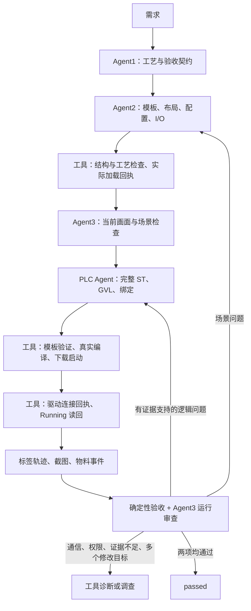

# 多模态多 Agent 架构 v2

保留 Agent1、Agent2、Agent3 和 PLC Agent，加入确定性编排层、工艺契约、部件语义库和交接包。模型提出产物与诊断，编排器校验、执行工具、管理版本及决定下一步。角色可使用同一模型服务或不同模型，Agent3 必须支持图片。当前实现串行修改共享场景和工程。

## 执行顺序

| 角色 | 输入 | 输出与约束 |
| --- | --- | --- |
| Agent1 | 需求、真实模板目录、协议、部件经验 | task.json + execution_contract；每步进入条件、命令、完成条件、超时、发料限制、停止复位和验收 |
| Agent2 | 工艺、模板配置、前版计划、反馈 | 完整 scene-plan；工具生成 XML/manifest/I/O；布局 XZ、安装 Y、旋转、工作模式与发料一起规划 |
| Agent3 | 当前版本画面、信号轨迹、PLC 诊断、验收结果 | 结构化诊断；先定位最早卡住的工艺步骤，再区分观测、原因假设和证据支持的原因 |
| PLC Agent | 工艺、实际 Tag Key、部件语义、线上编码、完整前版程序 | 完整声明、实现、GVL、绑定；状态机落实极性、发料互锁、稳定采样和超时 |
| 编排器/工具 | 已提交产物、可信配置 | 单写入者、版本验证、真实加载/编译/连接回执、有限修复和确定性验收 |

## 交接方式

每次模型调用前写入 handoffs/NNN-role.json：发送者/接收者、阶段、task/scene/io/plc/config/agent_policy 版本、输入路径与 SHA、预期输出、约束及最近四次修复记录。模型回传 handoff_id；调用前后核验输入与版本。旧回复、错交接和变化中的输入不能继续执行。

传递正式产物和诊断，不把整段聊天交给下一角色。场景修复读取工艺、前版场景与反馈；PLC 修复读取 I/O、完整前版程序和真实诊断；运行审查读取新画面、轨迹、启动回执与验收报告。短期修复记录由编排器保存；长期部件经验放入限定版本的知识文件，尚未实现自动维护知识库。

execution_contract 将“单件分拣”落实为 tracking_mode=single_item、max_in_flight=1、PLC 控制发料和 items_per_enable=1。加载前检查实际 Emitter.UpTo=1、未强制输出、唯一驱动映射，失败进入场景修复。PLC 还要只在 feed 开启 Emit，退出 feed 关闭，上一件离开前禁止再发。静态检查证明场景约束，控制与隔离仍需运行证据。

执行步骤必须与 task.process 一一对应，包含 preconditions、commands、completion、timeout_seconds，另外记录 startup/shutdown。当前验证器限定 Emitter 发料，其他供料设备需要扩展。旧文件可被离线工具读取，实际 v2 Planner 必须输出新契约。

## 部件知识与提示词

factoryio_agents/knowledge/component-semantics.json 保存 Factory I/O 2.5.8 下已观察到的行为：反射式传感器占用为 False，漫反射式到位为 True；PopUpWheelSorter SingleBinary 的 Left/Right 负责转向，Forward 使能升起与电机，侧向输送也需要它；Emitter Default 模式 UpTo=1 配合 PLC 使能，关闭使能后重置已发数量。

规则按 prefab、工作模式、类型和内部分组绑定到实际 Tag Key。名称允许重复或修改。实际加载回执 app_version 匹配后才标记 app_version_confirmed；未知版本、模式、结构保留不确定性。模板提示上下文现在保留工作模式、Emitter 限额/周期、Parts/Bases、Sensor、Encoder 配置；实际生成配置也写入 manifest。

提示词位于 factoryio_agents/prompts：common.md 管理交接、工具边界、事实/假设和完整修复；planner.md 管理工艺契约；scene.md 管理安装、配置与发料；vision.md 管理证据、诊断和分流；plc.md 管理控制、信号语义、完整代码与复测。prompts.py 一次加载策略快照，SHA 写入 agent-policy.json、交接包和 versions。修改提示词后重启编排进程，避免策略混用；安装包包含这些文件。

## 诊断与修复

每条反馈有 category、target、object_ids、observed、expected、evidence_ids、confidence、suggestion，以及 diagnosis：process_step、signal_keys、causal_status、hypothesis、alternatives、discriminating_check、expected_result、repair_scope、retest。

例如侧向分流卡住，先报告 route 步骤未完成。原因可能是驱动断开、物料未到位、转向开启但 Forward 未使能。下一步同时采集到位、转向、Forward 与驱动状态，并预测什么测量能区分这些原因。证据支持输出错误后才修改对应状态，再以单件侧向分流和一次计数复测。此例说明反馈格式，不是新的现场诊断。

原因未证实时返回 inconclusive；自动修复要求 supported。PLC 逻辑诊断还需信号或 PLC 诊断，图片独自不能支持。置信度高不能替代证据。

| 问题 | 路由 |
| --- | --- |
| 位置、朝向、安装、发料设置 | scene：重新生成、加载、审查 |
| 已核实的真实编译错误 | plc：完整诊断与前版代码修复 |
| 有信号证据支持的状态/输出错误 | plc：定向修复并复测 |
| 认证、权限、Gateway、服务、驱动、工具失败 | tools：不重写 ST |
| 需求矛盾、未知部件、标定缺失 | planner/调查：补齐契约或测量 |
| 只有卡住的图片、证据不足、多个修改目标 | investigate/needs_attention：先做区分原因的实验 |

修复写入 repair-history.json，默认场景与 PLC 各最多三次。只改交接 ID、notes、unresolved 不算 PLC 内容修复；内容不变返回 no_progress，避免重复编译/下载。场景改变后清空旧 PLC 修复上下文并重新验证，即使标签名未变也不能复用旧运行证据。

当前自动循环覆盖 scene/plc 的明确单目标修复。tools、planner、investigate 和混合目标返回 needs_attention，尚未实现自动诊断实验调度。长期案例检索、修复效果评分及恢复执行也尚未实现。

## 启动和证据

新增 factoryio.connect_command：可信 argv 调用 workflow_hook.py connect，读取当次 request 并创建新 receipt。在下载启动后检查真实驱动、连接、端点、当前场景和 nonce，exit=0 不够。写 Run 后读取未强制的 Running 输入，超时交给工具层。自动 run 采集后回到停止状态；本轮没有执行该流程，现有软件未因代码修改被停止。

本机 config.local.json 已加入连接 hook，保留 deploy=false、runtime_control=false 和未配置模型服务。模板准备、下载、服务权限与设备认证仍由对应适配器处理。新 hook 组合通过模拟测试，本轮没有重新联机或做在线 PLC 探测。

HMI Auto/Manual、Start 脉冲需要独立、可信、按 Tag Key 限定的操作方案。generic run 当前只自动控制仿真 Run/Reset，尚未自动完成全部 HMI 操作；Planner 的 startup 自由文本不会直接执行。现有基线的操作输入已记录，不代表新模型闭环已覆盖此能力。

视觉上下文优先保留物料事件原始来源、强制/故障变化、计数变化、离散跳变及相邻窗口。通常最多 40 个采样，事件来源与关键故障可超过软上限。完整轨迹仍保留，提示列出遗漏采样/跳变数量。它减少上下文遗漏，不能补回采集间隔未捕获的脉冲；必要时补采更快轨迹、特定窗口或更多视图。

确定性验收作为独立证据交给 Agent3；passed 要求行为验收和审查同时通过。编译、应用 Run、Modbus 连接、仿真 Running、运动计数、标定后的逐件分流分别记录。Keep 在线探测的全链路运行不干扰性未通过，运行监测继续使用 Factory I/O 标签与截图。

## 验证范围

测试包含实际四个角色包装器交接、版本与输入变化拒绝、发料约束、图片错误归因、短脉冲和事件来源保留。模型回复、图片内容、软件适配器、验收器均明确模拟；证明编排与契约约束，不证明外部多模型或新的物理验收。旧 demo 是 scripted legacy fixture，不代表 v2 Planner 契约全部通过。

此前真实基线已汇总到 artifacts/weight-live-start-002/live-start-report.json：184.704 秒、695 个采样，左/前/右计数 3/5/7，无故障，31 绑定，编译 0 错误 0 警告。它证明已保存的启动观察；仍需重量标定、逐件重量与出口关联、停止/复位/超时专项验收。

本轮 161 项单元测试通过，wheel 内提示词/知识文件及隔离导入通过；旧 demo 兼容检查通过，未配置模型时 prepare 返回 needs_configuration。可审查的人工 v2 参考位于 artifacts/architecture-v2-reference-001，包含具体工艺条件、交接包、56 对象/31 映射及静态工艺验证；没有加载该参考场景或生成新联机结果。
