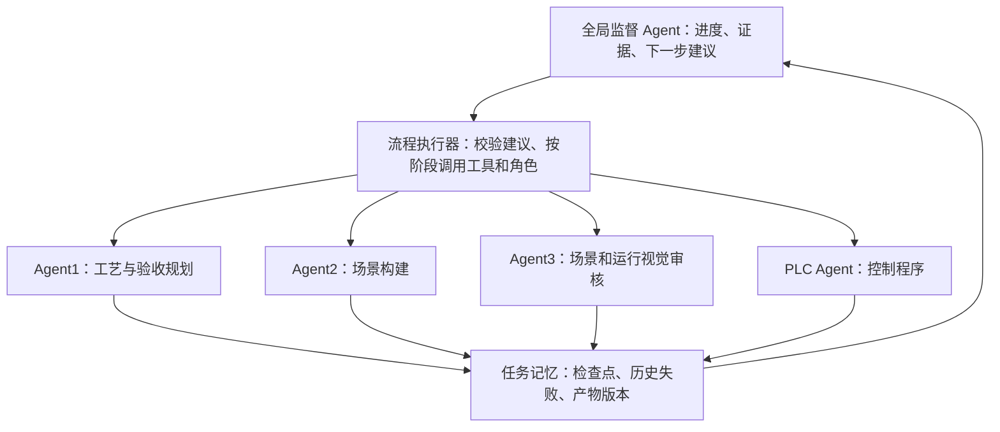

# 任务记忆、断点恢复与全局监督

原先正式 CLI 每次创建全新任务，只在一次运行内部传递修复历史。日志和训练候选已经持久化，
但未作为通用恢复入口使用。旧 `tools/resume_agent_scene.py` 是早期场景阶段调试脚本，
带有当时的具体配置约束；后续使用正式 CLI 的 `--resume`。

## 职责



监督模型负责基于证据推荐下一步，不生成场景坐标、PLC 逻辑或自由格式命令。
它默认复用 Planner 的文本模型服务，也可以配置独立 `llm.role_providers.supervisor`。
本机 `supervisor.enabled=true`，运行结束后调用真实模型分析结果。
每个流程状态转换都会保存工具生成的进度视图，失败后监督模型读取完整审计及恢复计划。
运行验收失败且审核指向 PLC 或待调查问题时，监督模型还会结合当前源码、实测信号和原审核
进行一次有界调查。包括审核标成 supported 的建议，也必须重新检查代码中的因果关系。
保存 `runtime-investigation.json`；它必须引用当前源码和实际 tag 记录才能建议 PLC 修复，
不能宣布通过、改变验收规则或取代下一轮的新截图审核。
视觉与监督模型使用经过标记的精简证据视图：静态标签列集中保存，样本保留原始值、
强制/故障属性和来源 ID；重复问题合并计数，长引用列表给出摘要及完整列表哈希。
原始运行证据和交接文件保持完整，物理验收仍读取原始样本。不会将未知属性视为健康。
PLC 和监督角色单独开启思考模式并使用 24000 输出预算；`finish_reason=length` 明确归为
模型输出预算问题，不再原样重试相同请求。
现有有界场景/PLC 修复仍由执行器控制；跨进程继续使用 `--resume`，没有无限自动重试循环。

工具限制监督模型的选择：有依据的场景问题交给场景角色，PLC 问题交给 PLC 角色，
认证、通信、接口和软件故障交给工具。没有完整验收证据不能选择 `done`。
历史失败为观察记录，不能直接当成本次状态或确认根因。

## 记忆层

| 位置 | 内容 |
|---|---|
| `runs/<run>/memory/checkpoints.json` | 规划、场景、I/O 和 PLC 产物的文件哈希、设计输入及依赖版本 |
| `runs/<run>/memory/planner-stages/` | 已接受的规划子任务及原始候选 ID；后续子任务失败时可复用 |
| `runs/<run>/memory/scene-stages/` | 已接受的布局或配置子任务；配置失败保留已校验布局 |
| `runs/<run>/memory-context.json` | 本次检索到的相关历史失败；按负责角色进入交接包 |
| `agent_memory/experiences/` | 同需求的失败观察，关联原始结果哈希与版本；旧运行按需迁入 |
| `runs/<run>/resume.json` | 恢复来源、复用产物、失效原因和须重新执行的联机步骤 |
| `runs/<run>/supervisor-state.json` | 工具维护的全局进度、证据和允许的下一步操作 |
| `runs/<run>/supervisor-input.json`、`supervisor-decision.json` | 监督模型实际收到的信息与经过校验的建议 |

子任务复用要求输入和对应角色提示词相同，并重新执行合同检查。原始模型回复不改写。
恢复保留原目录，在新目录复制所需产物及来源候选；历史结果归档在 `memory/source-*.json`。
恢复后的 `roles` 统计整条来源链，`roles_this_attempt` 单独统计本次四个工作角色的调用数。
监督调用在训练候选中以 `role=supervisor` 独立记录。
复制目录后，工具仅重定位 manifest/结构检查中的场景路径，原场景字节和 I/O 保持不变；
`memory/relocation.json` 保存前后哈希。新的原生回执路径不改变 PLC 设计身份；信号 GUID、
映射、极性或确认状态变化仍会使旧程序失效，完整原生回执仍参与证据版本检查。

设计输入、协议、设备配置或部件知识变更使相关产物失效；角色提示词变更只影响该角色
及其下游。新加载的 I/O 语义发生变化会使旧 PLC 程序失效，保留规划和场景重新生成 PLC。
修改过的产物、模板或不完整的来源证据会阻止恢复，不能绕过原来的完整验收要求。

已经保存的设计可以复用。软件加载、几何复核、当前截图审核、编译下载、连接、运行采样
和验收必须重新执行。过去的 PLC Run、连接回执和验收结果不能证明当前软件状态。
恢复当前仍会重新编译下载已复用的 PLC 源码；尚未实现跳过下载的在线应用身份校验。
`codesys.ensure_local_services=true` 时，部署前查询 Gateway/Runtime，尝试以当前进程权限启动。
服务停止且无 START 权限会提前保存 `service-preflight.json` 并停止，保留程序，避免再等 IDE
扫描超时。服务 Running 仍不能证明 PLC 应用已下载或进入 Run。
模型测试的等待条件超时会保存实际样本和 `probe_failure`，交给验收和审核；未执行的测试
继续判失败。原生按钮/接口调用失败仍归工具，不伪造成控制逻辑诊断。

## 命令

先检查恢复计划，不调用模型、不操作软件：

```powershell
& .\.venv\Scripts\python.exe run_agents.py --resume runs\observer-sc001-20261011-024 --resume-inspect
```

从断点继续，不必重新输入原始需求：

```powershell
& .\.venv\Scripts\python.exe run_agents.py --resume runs\observer-sc001-20261011-024
```

明确要求重新生成 PLC，保留规划和场景：

```powershell
& .\.venv\Scripts\python.exe run_agents.py --resume runs\observer-sc001-20261011-024 --restart-from plc
```

只让全局监督模型分析指定运行，不操作 Factory I/O 或 PLC：

```powershell
& .\.venv\Scripts\python.exe run_agents.py --supervise runs\observer-sc001-20261011-024
```

用监督模型调查最后一轮有实测证据的失败，不操作软件，也不改写源码或历史结果：

```powershell
& .\.venv\Scripts\python.exe run_agents.py --investigate runs\observer-sc001-20261011-030
```

复用已通过任务的设计，并重新执行全部联机验收：

```powershell
& .\.venv\Scripts\python.exe run_agents.py --resume runs\observer-sc001-20261011-031 --revalidate
```

`--revalidate` 必须配合 `--resume`。普通恢复仍拒绝已通过来源；再次验收不能复制旧验收
作为新结果，`resume.json` 会标记用途和检查时的来源状态。检查点没有失败记录时不会被
当作历史故障交给工作角色。

`--out` 仍须指定全新目录，禁止覆盖原运行。恢复保持原需求；改变需求应启动新任务。
`--check` 和 `--resume-inspect` 不调用监督模型。失败不会自动成为成功 SFT 或 DPO 正样本。

## 已验证范围（2026-10-11）

- 311 项离线测试通过，包含通信失败后的设计复用、重新执行联机工具、原目录不变、
  哈希篡改拒绝、角色及依赖失效、规划子任务恢复、布局复用、监督因果调查边界、
  截断回复路由、精简证据保真和显式再次验收。
- 正式 CLI 已读取第 024 轮真实产物，确认可以复用任务和场景。
  PLC 提示词在原失败后更新，所以该层失效，后续需要重新生成。
  记录：`artifacts/memory-resume-20261011-001/resume-plan.json`。
- 真实监督模型已分析第 024 轮，建议 `investigate_tools`，保留任务与场景，调查阻挡截图
  的原生窗口。输入、回复和原始模型候选保存在 `artifacts/supervisor-review-20261011-001/`。
- 第 027 轮已通过正式 CLI 恢复任务/场景，真实加载、审核、编译下载和连接；供料脉冲逻辑
  导致流程未开始。保存原始失败，修复了等待超时不能进入验收和审核的问题。
- 第 028 轮仍复用规划/场景，框架自行根据编译错误修复 PLC。实际运行 10/14 项检查通过，
  第二个箱子在出口处停止，后续操作测试没有触发，视觉审核 inconclusive。
- 第 029 轮视觉审核提出 PLC 修复，PLC Agent 自动生成修正版且编译通过；部署阶段 Runtime
  服务停止、设备扫描超时。没有完成后续运行，不能把修正版算作成功。
- 第 030 轮真实监督调查识别了停留计时逻辑取反和出口提前停止；PLC 请求的 12000
  输出预算全部被思考消耗，观察者中断了相同请求的再次重试。保存中断记录，未算成功。
- 精简后的第 030 轮模型证据视图由 258595 字符降至 54708 字符（减少 78.84%），
  原始证据仍为 4617508 字符且哈希不变。独立 `--investigate` 调用真实监督模型成功完成，
  原始候选和证据体积对照保存在 `artifacts/observer-sc001-20261011-030/`。
- 第 031 轮框架根据真实监督调查自动生成 PLC 修复，真实编译、下载、运行与 Modbus
  连接完成；14/14 项物理检查和新一轮运行视觉审核通过。旧审计要求角色集合恰等于四个
  角色，误拒绝新增的监督产物，原 `result.json` 保留该失败。已改为检查必需角色的子集，
  每个额外监督产物仍须逐项验证模型来源；没有修改历史结果或验收阈值。
- 第 032 轮普通恢复被“已通过来源”入口拦截；第 033 轮新增再次验收入口后发现成功检查点
  的空失败字段处理错误。两次入口失败分别归档，修复没有改写模型产物。
- 第 034 轮正式 CLI 使用 `--resume runs/observer-sc001-20261011-031 --revalidate`，
  复用任务/场景/PLC，重新加载、视觉复核、真实编译下载、连接与采样。14/14 项实测检查
  通过，新一轮运行视觉审核通过，所有完成门均为 true；`live_pipeline_passed=true`，
  CLI 退出码 0，监督决策为 `done`。本轮未调用规划、场景或 PLC 模型重新生成设计，
  没有手工产物覆盖，也没有运行中修改框架源码。
  结果：[第 034 轮 result.json](../runs/observer-sc001-20261011-034/result.json)。
  场景：[scene.factoryio](../runs/observer-sc001-20261011-034/scene-000/scene.factoryio)。
  工程：[example1.project](../runs/observer-sc001-20261011-034/scene-000/plc-000/deployment/project/example1.project)。
- 当前实测通过范围为 SC001 的上述 14 项合同检查；复位后再次启动的中途工件恢复、
  多输送机和数值通道等情况尚未由本轮证明。训练候选保持 pending，不自动晋升为 SFT/DPO 正样本。
