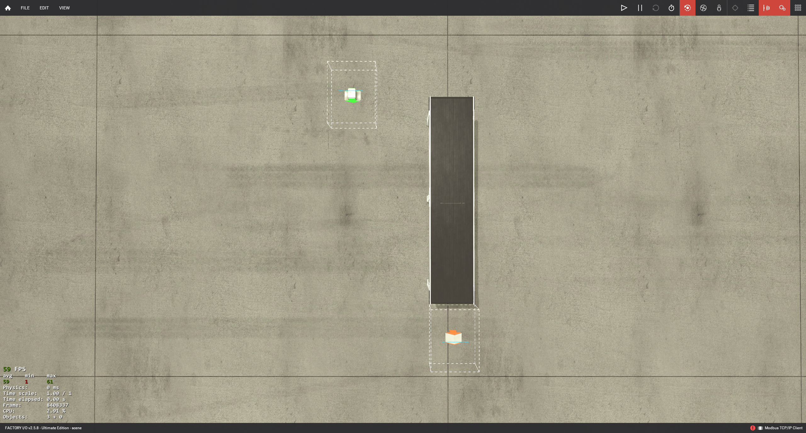
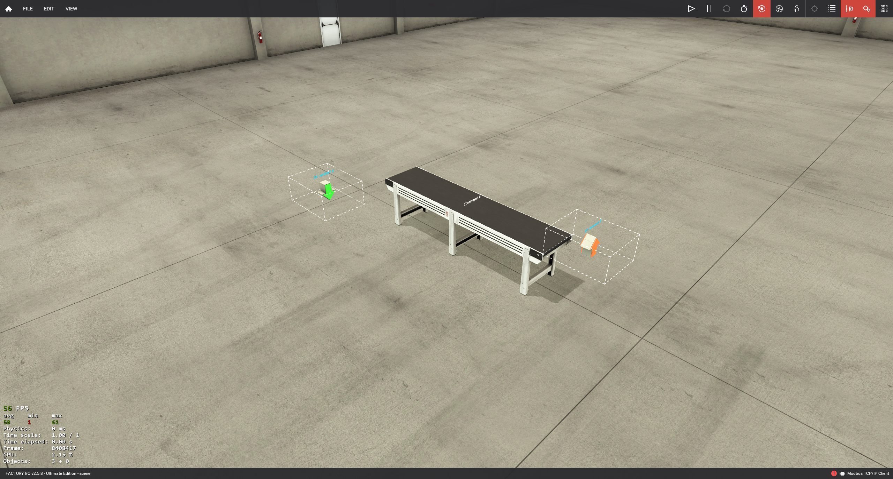
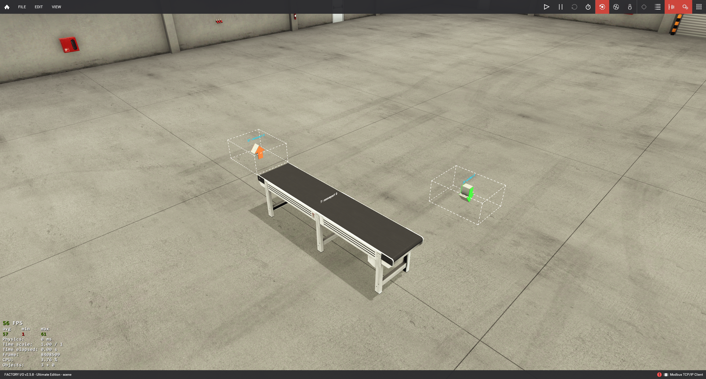

# Qwen 两次失败调用：完整交互审阅

从原始调用记录提取；没有重新调用模型或操作 Factory I/O，也没有修改原始记录。

**两次原始 response_text 都是 `[]`，不是 `null`。** structured_output 的 null 表示框架未接受到合法对象。第二次 payload 中的 rejected_output: null 也由框架生成。

请求模型名：`qwen3.8-flash`。第一次 json_schema，第二次 json_object；两次 HTTP 200、finish_reason=stop。原始返回没有截断证据；返回空数组的具体原因尚未确定。

本记录保存最终 system/user、实际图片副本及顺序、API 参数、响应元数据、原始 message content。认证头、原始 HTTP 响应包和逐个 SSE 数据包未保存；以下内容是请求/回复审阅材料，不是网络抓包。

## 三张实际图片

1. `image-0-top` / `top`，SHA256 `39cec2922e508d6d9d3c777a0a68f39acfef7fb83459c8ea4722c1f4bbc97d30`。



2. `image-0-iso_a` / `iso_a`，SHA256 `91e63627be9dba02590ee20c57cdb9300b7f12df73bdbe565542b891e024dd69`。



3. `image-0-iso_b` / `iso_b`，SHA256 `f74ff08b1f51e57918f39b45fec129c34f88fa861c1d5a7a45e87ea224a00298`。



## 第 1 次调用

上海时间：`2026-10-14T11:45:49.726917+08:00`；用时 `4.860` 秒。

[原始 JSON](../training-data/candidates/f392c218793f4af99239fe8e8dc986ec.json) · [精确 User 文本](call-01.user.txt) · [原始回复文本](call-01.response.txt)

### System prompt

```text
You inspect an ACTUALLY LOADED Factory I/O scene using multiple views.
original_requirement and the independent check_plan define the target. Images are
observations; generated placements and a designer's self-assessment are not proof.

Work in this order:
1. Identify actual_objects and relevant regions using image_manifest, view IDs and
   sourced component guidance. Do not guess when labels or identities are ambiguous.
2. Review obvious missing/extra objects and visible layout inconsistencies globally.
3. Evaluate each check's question and expected_relation. Compare visible evidence
   with the requirement; use other views to resolve occlusion and perspective.
4. Return satisfied, violated or unobservable for EVERY supplied check. Identify
   objects and relations, observed versus required layout, and supporting image IDs.
   For violations, object_ids names objects needing correction; unchanged reference
   objects remain identifiable from the check. For satisfaction, identify all checked objects.
   For unobservable checks, explain missing evidence and request a supported view.
5. Separate visible placement from material dynamics, sensor electrical response,
   PLC logic and unseen geometry. Static pictures cannot prove runtime behavior.

Do not invent absolute coordinates, unseen dimensions, sensing properties or new
hard requirements. Object function text is identification context only. Return the
per-check report and global observations as a JSON object matching the supplied response schema.

```

### User 内容（按 JSON 缩进展示；精确发送文本见链接）

```json
{
  "phase": "scene_visual",
  "original_requirement": "构建一个用于静态检查的直线输送布局：一条输送带、一个供料器和一个末端移除器。供料器位于输送带上游承载面上方，移除器覆盖下游延伸路径。只做布局和图片检查，不启动 PLC。",
  "requirement_spec": {
    "schema_version": 1,
    "original_requirement": "构建一个用于静态检查的直线输送布局：一条输送带、一个供料器和一个末端移除器。供料器位于输送带上游承载面上方，移除器覆盖下游延伸路径。只做布局和图片检查，不启动 PLC。",
    "context_fragments": [
      {
        "source_text": "构建一个用于静态检查的直线输送布局",
        "reason": "Indicates the purpose is static checking, not runtime behavior."
      },
      {
        "source_text": "和",
        "reason": "Conjunction connecting the list of required components; no physical constraint."
      },
      {
        "source_text": "只做布局和图片检查，不启动 PLC。",
        "reason": "Explicitly limits the scope to layout and image inspection, excluding PLC activation."
      }
    ],
    "requirements": [
      {
        "requirement_id": "REQ-COUNT-CONVEYOR",
        "source_text": "一条输送带",
        "origin": "explicit_user",
        "phase": "static_scene",
        "subject_role": "conveyor",
        "target_role": null,
        "predicate": "count",
        "arguments": {
          "equals": 1,
          "capability": "conveyor"
        },
        "required": true,
        "evidence_methods": [
          "structure"
        ]
      },
      {
        "requirement_id": "REQ-COUNT-FEEDER",
        "source_text": "一个供料器",
        "origin": "explicit_user",
        "phase": "static_scene",
        "subject_role": "feeder",
        "target_role": null,
        "predicate": "count",
        "arguments": {
          "equals": 1,
          "prefab": "Emitter"
        },
        "required": true,
        "evidence_methods": [
          "structure"
        ]
      },
      {
        "requirement_id": "REQ-COUNT-REMOVER",
        "source_text": "一个末端移除器",
        "origin": "explicit_user",
        "phase": "static_scene",
        "subject_role": "remover",
        "target_role": null,
        "predicate": "count",
        "arguments": {
          "equals": 1,
          "prefab": "Remover"
        },
        "required": true,
        "evidence_methods": [
          "structure"
        ]
      },
      {
        "requirement_id": "REQ-FEEDER-ABOVE-CONVEYOR",
        "source_text": "供料器位于输送带上游承载面上方",
        "origin": "explicit_user",
        "phase": "static_scene",
        "subject_role": "feeder",
        "target_role": "conveyor_upstream",
        "predicate": "visual_relation",
        "arguments": {
          "question": "Is the feeder positioned above the upstream carrying surface of the conveyor?"
        },
        "required": true,
        "evidence_methods": [
          "visual"
        ]
      },
      {
        "requirement_id": "REQ-REMOVER-COVERS-DOWNSTREAM-PATH",
        "source_text": "移除器覆盖下游延伸路径",
        "origin": "explicit_user",
        "phase": "static_scene",
        "subject_role": "remover",
        "target_role": "conveyor_downstream",
        "predicate": "visual_relation",
        "arguments": {
          "question": "Does the remover cover the downstream extension path of the conveyor?"
        },
        "required": true,
        "evidence_methods": [
          "visual"
        ]
      }
    ]
  },
  "actual_objects": [
    {
      "id": "conveyor1",
      "prefab": "BeltConveyor4M",
      "roles": [
        "conveyor",
        "conveyor_upstream",
        "conveyor_downstream"
      ],
      "function": "Main belt conveyor that transports items from upstream to downstream, serving as the reference for both upstream and downstream spatial constraints."
    },
    {
      "id": "emitter1",
      "prefab": "Emitter",
      "roles": [
        "feeder"
      ],
      "function": "Feeder that emits items onto the upstream carrying surface of the conveyor."
    },
    {
      "id": "remover1",
      "prefab": "Remover",
      "roles": [
        "remover"
      ],
      "function": "Remover that covers the downstream extension path beyond the conveyor end."
    }
  ],
  "check_plan": {
    "checks": [
      {
        "check_id": "REQ-FEEDER-ABOVE-CONVEYOR-1",
        "requirement_ids": [
          "REQ-FEEDER-ABOVE-CONVEYOR"
        ],
        "operator": "visual_relation",
        "object_ids": [
          "emitter1",
          "conveyor1"
        ],
        "relation_ids": [
          "rel1"
        ],
        "question": "Does the visible layout satisfy: 供料器位于输送带上游承载面上方?",
        "expected_relation": {
          "predicate": "visual_relation",
          "parameters": {
            "question": "Is the feeder positioned above the upstream carrying surface of the conveyor?"
          },
          "source_text": [
            "供料器位于输送带上游承载面上方"
          ]
        },
        "preferred_views": [
          "top",
          "iso_a",
          "iso_b"
        ]
      },
      {
        "check_id": "REQ-REMOVER-COVERS-DOWNSTREAM-PATH-1",
        "requirement_ids": [
          "REQ-REMOVER-COVERS-DOWNSTREAM-PATH"
        ],
        "operator": "visual_relation",
        "object_ids": [
          "remover1",
          "conveyor1"
        ],
        "relation_ids": [
          "rel2"
        ],
        "question": "Does the visible layout satisfy: 移除器覆盖下游延伸路径?",
        "expected_relation": {
          "predicate": "visual_relation",
          "parameters": {
            "question": "Does the remover cover the downstream extension path of the conveyor?"
          },
          "source_text": [
            "移除器覆盖下游延伸路径"
          ]
        },
        "preferred_views": [
          "top",
          "iso_a",
          "iso_b"
        ]
      }
    ],
    "coverage": {
      "REQ-COUNT-CONVEYOR": [
        "REQ-COUNT-CONVEYOR-1"
      ],
      "REQ-COUNT-FEEDER": [
        "REQ-COUNT-FEEDER-1"
      ],
      "REQ-COUNT-REMOVER": [
        "REQ-COUNT-REMOVER-1"
      ],
      "REQ-FEEDER-ABOVE-CONVEYOR": [
        "REQ-FEEDER-ABOVE-CONVEYOR-1"
      ],
      "REQ-REMOVER-COVERS-DOWNSTREAM-PATH": [
        "REQ-REMOVER-COVERS-DOWNSTREAM-PATH-1"
      ]
    },
    "acceptance_scope": "visible static relations only; no runtime/electrical response proof"
  },
  "image_manifest": [
    {
      "id": "image-0-top",
      "kind": "image",
      "view_id": "top",
      "sha256": "39cec2922e508d6d9d3c777a0a68f39acfef7fb83459c8ea4722c1f4bbc97d30",
      "scene_sha256": "0de1cea16c15955a7b4711b9fa538562fd5a35786659ea02366e65c21bae0867",
      "timestamp": "2026-10-14T03:45:46.4400994Z",
      "load_request_id": "05aef455712b4c84badebf05c278078b",
      "capture_request_id": "c54cd627e2f14fca90bd09082760fcd0"
    },
    {
      "id": "image-0-iso_a",
      "kind": "image",
      "view_id": "iso_a",
      "sha256": "91e63627be9dba02590ee20c57cdb9300b7f12df73bdbe565542b891e024dd69",
      "scene_sha256": "0de1cea16c15955a7b4711b9fa538562fd5a35786659ea02366e65c21bae0867",
      "timestamp": "2026-10-14T03:45:47.9384078Z",
      "load_request_id": "05aef455712b4c84badebf05c278078b",
      "capture_request_id": "9fdc128d93034c569dcd2bed9b4fd268"
    },
    {
      "id": "image-0-iso_b",
      "kind": "image",
      "view_id": "iso_b",
      "sha256": "f74ff08b1f51e57918f39b45fec129c34f88fa861c1d5a7a45e87ea224a00298",
      "scene_sha256": "0de1cea16c15955a7b4711b9fa538562fd5a35786659ea02366e65c21bae0867",
      "timestamp": "2026-10-14T03:45:49.4167559Z",
      "load_request_id": "05aef455712b4c84badebf05c278078b",
      "capture_request_id": "bb1f704045674aed8ff1c37d9b74b45d"
    }
  ],
  "supported_views": [
    "top",
    "iso_a",
    "iso_b"
  ],
  "relevant_component_guidance": {
    "knowledge_sha256": "d736c0ae33df1fe5f69040337a14acbd0dbd2a979fb6973a020ddb8eb0bf2d26",
    "reference_kind": "official_component_documentation",
    "requested_prefabs": [
      "BeltConveyor4M",
      "Emitter",
      "Remover"
    ],
    "components": [
      {
        "component_id": "parts:light-load#belt-conveyors",
        "prefabs": [
          "BeltConveyor4M"
        ],
        "official_name": "Belt Conveyors",
        "function": "Transport light-load cargo using a belt conveyor.",
        "function_basis": "curated_summary_of_official_text",
        "sources": [
          {
            "chapter_id": "parts:light-load#belt-conveyors",
            "url": "https://docs.factoryio.com/manual/parts/light-load/#belt-conveyors"
          }
        ],
        "markers": [
          {
            "text": "The white arrow indicates the conveying flow direction.",
            "basis": "official_text",
            "source_url": "https://docs.factoryio.com/getting-started/creating-a-scene/"
          }
        ]
      },
      {
        "component_id": "parts:emitter#emitter",
        "prefabs": [
          "Emitter"
        ],
        "official_name": "Emitter",
        "function": "Create configured items inside an emission volume. While an item remains in that volume, no additional item is emitted.",
        "function_basis": "curated_summary_of_official_text",
        "sources": [
          {
            "chapter_id": "parts:emitter#emitter",
            "url": "https://docs.factoryio.com/manual/parts/emitter/#emitter"
          }
        ],
        "appearance": {
          "text": "Official illustration shows a white dashed volume and a downward arrow.",
          "basis": "official_image_observation"
        },
        "markers": [
          {
            "text": "The dashed volume depicts the region associated with emission; compare it with the intended receiving support surface.",
            "basis": "text_and_image_interpretation"
          }
        ]
      },
      {
        "component_id": "parts:remover#remover",
        "prefabs": [
          "Remover"
        ],
        "official_name": "Remover",
        "function": "Remove configured items from the scene when they intersect the remover volume and removal is enabled.",
        "function_basis": "curated_summary_of_official_text",
        "sources": [
          {
            "chapter_id": "parts:remover#remover",
            "url": "https://docs.factoryio.com/manual/parts/remover/#remover"
          }
        ],
        "appearance": {
          "text": "Official illustration shows a white dashed volume and an upward arrow.",
          "basis": "official_image_observation"
        },
        "markers": [
          {
            "text": "The dashed volume depicts the removal region; compare its overlap with the intended item arrival path.",
            "basis": "text_and_image_interpretation"
          }
        ]
      }
    ],
    "missing_prefabs": []
  },
  "context_manifest": {
    "prompt_version": "issue4-guided-context-v3",
    "kind": "visual",
    "sources": {
      "requirements_sha256": "40849ba3aa0a81fa62c8c3d9c825f7cb0f8bb60444af4616fb728465e195ad00",
      "native_geometry_sha256": "0ccc683e8a9fd6c87f1ffa6f5ce6caece25ff939b7bdbca4faf35e56d1bb7aef",
      "template_sources": {
        "source-04da4aaaacbb3e5e0ade": "04da4aaaacbb3e5e0adedba912df75dbaab6aaa157a25e80aac48268d22de59c",
        "source-7b6b0a6b063429d967cf": "7b6b0a6b063429d967cf7fe53af31a25e0eff977250f09f9e22ac41f94815918",
        "source-6862ca46dbe17012078c": "6862ca46dbe17012078c7169d9068497c0c7eff10b999a4880f34af4622bc535"
      },
      "knowledge_sha256": "d736c0ae33df1fe5f69040337a14acbd0dbd2a979fb6973a020ddb8eb0bf2d26"
    },
    "object_scope": [
      "conveyor1",
      "emitter1",
      "remover1"
    ],
    "field_sources": {
      "requirement_spec": "independent source quotes",
      "actual_objects": "current manifest identities plus design identification labels",
      "check_plan": "independently compiled checks",
      "image_manifest": "current load and capture receipts"
    },
    "limitations": [
      "Generated roles/functions are identification context, not independent ground truth.",
      "Native data describes this loaded software/version, not proven runtime behavior."
    ]
  }
}
```

实际图片附件顺序：

1. [top](../../../assets/39cec2922e508d6d9d3c777a0a68f39acfef7fb83459c8ea4722c1f4bbc97d30.png)，SHA256 `39cec2922e508d6d9d3c777a0a68f39acfef7fb83459c8ea4722c1f4bbc97d30`
2. [iso_a](../../../assets/91e63627be9dba02590ee20c57cdb9300b7f12df73bdbe565542b891e024dd69.png)，SHA256 `91e63627be9dba02590ee20c57cdb9300b7f12df73bdbe565542b891e024dd69`
3. [iso_b](../../../assets/f74ff08b1f51e57918f39b45fec129c34f88fa861c1d5a7a45e87ea224a00298.png)，SHA256 `f74ff08b1f51e57918f39b45fec129c34f88fa861c1d5a7a45e87ea224a00298`

### API 参数与响应元数据

```json
{
  "endpoint": "https://model-service-host.invalid/compatible-mode/v1/chat/completions",
  "provider": "AliyunLLM",
  "request_options": {
    "max_tokens": 8000,
    "enable_thinking": false
  },
  "response_format": {
    "type": "json_schema",
    "json_schema": {
      "name": "FactoryIO_vision",
      "strict": true,
      "schema": {
        "type": "object",
        "additionalProperties": false,
        "required": [
          "global_review",
          "check_results"
        ],
        "properties": {
          "global_review": {
            "type": "object",
            "additionalProperties": false,
            "required": [
              "status",
              "summary",
              "image_ids",
              "findings"
            ],
            "properties": {
              "status": {
                "type": "string",
                "enum": [
                  "satisfied",
                  "violated",
                  "unobservable"
                ]
              },
              "summary": {
                "type": "string"
              },
              "image_ids": {
                "type": "array",
                "items": {
                  "type": "string"
                }
              },
              "findings": {
                "type": "array",
                "items": {
                  "type": "object",
                  "additionalProperties": false,
                  "required": [
                    "object_ids",
                    "image_ids",
                    "observed",
                    "reason",
                    "repair_intent",
                    "status",
                    "requirement_ids"
                  ],
                  "properties": {
                    "object_ids": {
                      "type": "array",
                      "items": {
                        "type": "string"
                      }
                    },
                    "image_ids": {
                      "type": "array",
                      "items": {
                        "type": "string"
                      }
                    },
                    "observed": {
                      "type": "string"
                    },
                    "reason": {
                      "type": "string"
                    },
                    "repair_intent": {
                      "type": "string"
                    },
                    "status": {
                      "type": "string",
                      "enum": [
                        "violated",
                        "unobservable"
                      ]
                    },
                    "requirement_ids": {
                      "type": "array",
                      "items": {
                        "type": "string"
                      }
                    }
                  }
                }
              }
            }
          },
          "check_results": {
            "type": "array",
            "items": {
              "type": "object",
              "additionalProperties": false,
              "required": [
                "object_ids",
                "image_ids",
                "observed",
                "reason",
                "repair_intent",
                "check_id",
                "relation_ids",
                "status",
                "requested_view"
              ],
              "properties": {
                "object_ids": {
                  "type": "array",
                  "items": {
                    "type": "string"
                  }
                },
                "image_ids": {
                  "type": "array",
                  "items": {
                    "type": "string"
                  }
                },
                "observed": {
                  "type": "string"
                },
                "reason": {
                  "type": "string"
                },
                "repair_intent": {
                  "type": "string"
                },
                "check_id": {
                  "type": "string"
                },
                "relation_ids": {
                  "type": "array",
                  "items": {
                    "type": "string"
                  }
                },
                "status": {
                  "type": "string",
                  "enum": [
                    "satisfied",
                    "violated",
                    "unobservable"
                  ]
                },
                "requested_view": {
                  "type": [
                    "string",
                    "null"
                  ],
                  "enum": [
                    null,
                    "top",
                    "iso_a",
                    "iso_b"
                  ]
                }
              }
            }
          }
        }
      }
    }
  },
  "requested_model": "qwen3.8-flash",
  "returned_model": "qwen3.8-flash",
  "response_id": "chatcmpl-4d25e3ba-9fd5-9a0a-9723-84fc4e56f85e",
  "http_status": 200,
  "usage": {
    "prompt_tokens": 11635,
    "total_tokens": 11637,
    "completion_tokens": 2,
    "prompt_tokens_details": {
      "cached_tokens": 0,
      "image_tokens": 7554,
      "text_tokens": 4081
    },
    "completion_tokens_details": {}
  },
  "finish_reason": "stop",
  "streaming_requested": true,
  "response_mode": "sse",
  "stream_stats": {
    "packets": 4,
    "content_chars": 2,
    "done_received": true,
    "first_packet_seconds": 5.6e-05,
    "first_content_seconds": 9.6e-05
  }
}
```

### Qwen 原始返回

```text
[]
```

### 框架处理结果

```json
{
  "status": "call_error",
  "structured_output": null,
  "error": {
    "type": "ContractError",
    "message": "vision model response must be object"
  }
}
```

## 第 2 次调用

上海时间：`2026-10-14T11:45:54.664180+08:00`；用时 `5.635` 秒。

[原始 JSON](../training-data/candidates/b525e150812e45c4b15edcf7790cbef2.json) · [精确 User 文本](call-02.user.txt) · [原始回复文本](call-02.response.txt)

### System prompt

```text
You inspect an ACTUALLY LOADED Factory I/O scene using multiple views.
original_requirement and the independent check_plan define the target. Images are
observations; generated placements and a designer's self-assessment are not proof.

Work in this order:
1. Identify actual_objects and relevant regions using image_manifest, view IDs and
   sourced component guidance. Do not guess when labels or identities are ambiguous.
2. Review obvious missing/extra objects and visible layout inconsistencies globally.
3. Evaluate each check's question and expected_relation. Compare visible evidence
   with the requirement; use other views to resolve occlusion and perspective.
4. Return satisfied, violated or unobservable for EVERY supplied check. Identify
   objects and relations, observed versus required layout, and supporting image IDs.
   For violations, object_ids names objects needing correction; unchanged reference
   objects remain identifiable from the check. For satisfaction, identify all checked objects.
   For unobservable checks, explain missing evidence and request a supported view.
5. Separate visible placement from material dynamics, sensor electrical response,
   PLC logic and unseen geometry. Static pictures cannot prove runtime behavior.

Do not invent absolute coordinates, unseen dimensions, sensing properties or new
hard requirements. Object function text is identification context only. Return the
per-check report and global observations as a JSON object matching the supplied response schema.

```

### User 内容（按 JSON 缩进展示；精确发送文本见链接）

```json
{
  "phase": "scene_visual",
  "original_requirement": "构建一个用于静态检查的直线输送布局：一条输送带、一个供料器和一个末端移除器。供料器位于输送带上游承载面上方，移除器覆盖下游延伸路径。只做布局和图片检查，不启动 PLC。",
  "requirement_spec": {
    "schema_version": 1,
    "original_requirement": "构建一个用于静态检查的直线输送布局：一条输送带、一个供料器和一个末端移除器。供料器位于输送带上游承载面上方，移除器覆盖下游延伸路径。只做布局和图片检查，不启动 PLC。",
    "context_fragments": [
      {
        "source_text": "构建一个用于静态检查的直线输送布局",
        "reason": "Indicates the purpose is static checking, not runtime behavior."
      },
      {
        "source_text": "和",
        "reason": "Conjunction connecting the list of required components; no physical constraint."
      },
      {
        "source_text": "只做布局和图片检查，不启动 PLC。",
        "reason": "Explicitly limits the scope to layout and image inspection, excluding PLC activation."
      }
    ],
    "requirements": [
      {
        "requirement_id": "REQ-COUNT-CONVEYOR",
        "source_text": "一条输送带",
        "origin": "explicit_user",
        "phase": "static_scene",
        "subject_role": "conveyor",
        "target_role": null,
        "predicate": "count",
        "arguments": {
          "equals": 1,
          "capability": "conveyor"
        },
        "required": true,
        "evidence_methods": [
          "structure"
        ]
      },
      {
        "requirement_id": "REQ-COUNT-FEEDER",
        "source_text": "一个供料器",
        "origin": "explicit_user",
        "phase": "static_scene",
        "subject_role": "feeder",
        "target_role": null,
        "predicate": "count",
        "arguments": {
          "equals": 1,
          "prefab": "Emitter"
        },
        "required": true,
        "evidence_methods": [
          "structure"
        ]
      },
      {
        "requirement_id": "REQ-COUNT-REMOVER",
        "source_text": "一个末端移除器",
        "origin": "explicit_user",
        "phase": "static_scene",
        "subject_role": "remover",
        "target_role": null,
        "predicate": "count",
        "arguments": {
          "equals": 1,
          "prefab": "Remover"
        },
        "required": true,
        "evidence_methods": [
          "structure"
        ]
      },
      {
        "requirement_id": "REQ-FEEDER-ABOVE-CONVEYOR",
        "source_text": "供料器位于输送带上游承载面上方",
        "origin": "explicit_user",
        "phase": "static_scene",
        "subject_role": "feeder",
        "target_role": "conveyor_upstream",
        "predicate": "visual_relation",
        "arguments": {
          "question": "Is the feeder positioned above the upstream carrying surface of the conveyor?"
        },
        "required": true,
        "evidence_methods": [
          "visual"
        ]
      },
      {
        "requirement_id": "REQ-REMOVER-COVERS-DOWNSTREAM-PATH",
        "source_text": "移除器覆盖下游延伸路径",
        "origin": "explicit_user",
        "phase": "static_scene",
        "subject_role": "remover",
        "target_role": "conveyor_downstream",
        "predicate": "visual_relation",
        "arguments": {
          "question": "Does the remover cover the downstream extension path of the conveyor?"
        },
        "required": true,
        "evidence_methods": [
          "visual"
        ]
      }
    ]
  },
  "actual_objects": [
    {
      "id": "conveyor1",
      "prefab": "BeltConveyor4M",
      "roles": [
        "conveyor",
        "conveyor_upstream",
        "conveyor_downstream"
      ],
      "function": "Main belt conveyor that transports items from upstream to downstream, serving as the reference for both upstream and downstream spatial constraints."
    },
    {
      "id": "emitter1",
      "prefab": "Emitter",
      "roles": [
        "feeder"
      ],
      "function": "Feeder that emits items onto the upstream carrying surface of the conveyor."
    },
    {
      "id": "remover1",
      "prefab": "Remover",
      "roles": [
        "remover"
      ],
      "function": "Remover that covers the downstream extension path beyond the conveyor end."
    }
  ],
  "check_plan": {
    "checks": [
      {
        "check_id": "REQ-FEEDER-ABOVE-CONVEYOR-1",
        "requirement_ids": [
          "REQ-FEEDER-ABOVE-CONVEYOR"
        ],
        "operator": "visual_relation",
        "object_ids": [
          "emitter1",
          "conveyor1"
        ],
        "relation_ids": [
          "rel1"
        ],
        "question": "Does the visible layout satisfy: 供料器位于输送带上游承载面上方?",
        "expected_relation": {
          "predicate": "visual_relation",
          "parameters": {
            "question": "Is the feeder positioned above the upstream carrying surface of the conveyor?"
          },
          "source_text": [
            "供料器位于输送带上游承载面上方"
          ]
        },
        "preferred_views": [
          "top",
          "iso_a",
          "iso_b"
        ]
      },
      {
        "check_id": "REQ-REMOVER-COVERS-DOWNSTREAM-PATH-1",
        "requirement_ids": [
          "REQ-REMOVER-COVERS-DOWNSTREAM-PATH"
        ],
        "operator": "visual_relation",
        "object_ids": [
          "remover1",
          "conveyor1"
        ],
        "relation_ids": [
          "rel2"
        ],
        "question": "Does the visible layout satisfy: 移除器覆盖下游延伸路径?",
        "expected_relation": {
          "predicate": "visual_relation",
          "parameters": {
            "question": "Does the remover cover the downstream extension path of the conveyor?"
          },
          "source_text": [
            "移除器覆盖下游延伸路径"
          ]
        },
        "preferred_views": [
          "top",
          "iso_a",
          "iso_b"
        ]
      }
    ],
    "coverage": {
      "REQ-COUNT-CONVEYOR": [
        "REQ-COUNT-CONVEYOR-1"
      ],
      "REQ-COUNT-FEEDER": [
        "REQ-COUNT-FEEDER-1"
      ],
      "REQ-COUNT-REMOVER": [
        "REQ-COUNT-REMOVER-1"
      ],
      "REQ-FEEDER-ABOVE-CONVEYOR": [
        "REQ-FEEDER-ABOVE-CONVEYOR-1"
      ],
      "REQ-REMOVER-COVERS-DOWNSTREAM-PATH": [
        "REQ-REMOVER-COVERS-DOWNSTREAM-PATH-1"
      ]
    },
    "acceptance_scope": "visible static relations only; no runtime/electrical response proof"
  },
  "image_manifest": [
    {
      "id": "image-0-top",
      "kind": "image",
      "view_id": "top",
      "sha256": "39cec2922e508d6d9d3c777a0a68f39acfef7fb83459c8ea4722c1f4bbc97d30",
      "scene_sha256": "0de1cea16c15955a7b4711b9fa538562fd5a35786659ea02366e65c21bae0867",
      "timestamp": "2026-10-14T03:45:46.4400994Z",
      "load_request_id": "05aef455712b4c84badebf05c278078b",
      "capture_request_id": "c54cd627e2f14fca90bd09082760fcd0"
    },
    {
      "id": "image-0-iso_a",
      "kind": "image",
      "view_id": "iso_a",
      "sha256": "91e63627be9dba02590ee20c57cdb9300b7f12df73bdbe565542b891e024dd69",
      "scene_sha256": "0de1cea16c15955a7b4711b9fa538562fd5a35786659ea02366e65c21bae0867",
      "timestamp": "2026-10-14T03:45:47.9384078Z",
      "load_request_id": "05aef455712b4c84badebf05c278078b",
      "capture_request_id": "9fdc128d93034c569dcd2bed9b4fd268"
    },
    {
      "id": "image-0-iso_b",
      "kind": "image",
      "view_id": "iso_b",
      "sha256": "f74ff08b1f51e57918f39b45fec129c34f88fa861c1d5a7a45e87ea224a00298",
      "scene_sha256": "0de1cea16c15955a7b4711b9fa538562fd5a35786659ea02366e65c21bae0867",
      "timestamp": "2026-10-14T03:45:49.4167559Z",
      "load_request_id": "05aef455712b4c84badebf05c278078b",
      "capture_request_id": "bb1f704045674aed8ff1c37d9b74b45d"
    }
  ],
  "supported_views": [
    "top",
    "iso_a",
    "iso_b"
  ],
  "relevant_component_guidance": {
    "knowledge_sha256": "d736c0ae33df1fe5f69040337a14acbd0dbd2a979fb6973a020ddb8eb0bf2d26",
    "reference_kind": "official_component_documentation",
    "requested_prefabs": [
      "BeltConveyor4M",
      "Emitter",
      "Remover"
    ],
    "components": [
      {
        "component_id": "parts:light-load#belt-conveyors",
        "prefabs": [
          "BeltConveyor4M"
        ],
        "official_name": "Belt Conveyors",
        "function": "Transport light-load cargo using a belt conveyor.",
        "function_basis": "curated_summary_of_official_text",
        "sources": [
          {
            "chapter_id": "parts:light-load#belt-conveyors",
            "url": "https://docs.factoryio.com/manual/parts/light-load/#belt-conveyors"
          }
        ],
        "markers": [
          {
            "text": "The white arrow indicates the conveying flow direction.",
            "basis": "official_text",
            "source_url": "https://docs.factoryio.com/getting-started/creating-a-scene/"
          }
        ]
      },
      {
        "component_id": "parts:emitter#emitter",
        "prefabs": [
          "Emitter"
        ],
        "official_name": "Emitter",
        "function": "Create configured items inside an emission volume. While an item remains in that volume, no additional item is emitted.",
        "function_basis": "curated_summary_of_official_text",
        "sources": [
          {
            "chapter_id": "parts:emitter#emitter",
            "url": "https://docs.factoryio.com/manual/parts/emitter/#emitter"
          }
        ],
        "appearance": {
          "text": "Official illustration shows a white dashed volume and a downward arrow.",
          "basis": "official_image_observation"
        },
        "markers": [
          {
            "text": "The dashed volume depicts the region associated with emission; compare it with the intended receiving support surface.",
            "basis": "text_and_image_interpretation"
          }
        ]
      },
      {
        "component_id": "parts:remover#remover",
        "prefabs": [
          "Remover"
        ],
        "official_name": "Remover",
        "function": "Remove configured items from the scene when they intersect the remover volume and removal is enabled.",
        "function_basis": "curated_summary_of_official_text",
        "sources": [
          {
            "chapter_id": "parts:remover#remover",
            "url": "https://docs.factoryio.com/manual/parts/remover/#remover"
          }
        ],
        "appearance": {
          "text": "Official illustration shows a white dashed volume and an upward arrow.",
          "basis": "official_image_observation"
        },
        "markers": [
          {
            "text": "The dashed volume depicts the removal region; compare its overlap with the intended item arrival path.",
            "basis": "text_and_image_interpretation"
          }
        ]
      }
    ],
    "missing_prefabs": []
  },
  "context_manifest": {
    "prompt_version": "issue4-guided-context-v3",
    "kind": "visual",
    "sources": {
      "requirements_sha256": "40849ba3aa0a81fa62c8c3d9c825f7cb0f8bb60444af4616fb728465e195ad00",
      "native_geometry_sha256": "0ccc683e8a9fd6c87f1ffa6f5ce6caece25ff939b7bdbca4faf35e56d1bb7aef",
      "template_sources": {
        "source-04da4aaaacbb3e5e0ade": "04da4aaaacbb3e5e0adedba912df75dbaab6aaa157a25e80aac48268d22de59c",
        "source-7b6b0a6b063429d967cf": "7b6b0a6b063429d967cf7fe53af31a25e0eff977250f09f9e22ac41f94815918",
        "source-6862ca46dbe17012078c": "6862ca46dbe17012078c7169d9068497c0c7eff10b999a4880f34af4622bc535"
      },
      "knowledge_sha256": "d736c0ae33df1fe5f69040337a14acbd0dbd2a979fb6973a020ddb8eb0bf2d26"
    },
    "object_scope": [
      "conveyor1",
      "emitter1",
      "remover1"
    ],
    "field_sources": {
      "requirement_spec": "independent source quotes",
      "actual_objects": "current manifest identities plus design identification labels",
      "check_plan": "independently compiled checks",
      "image_manifest": "current load and capture receipts"
    },
    "limitations": [
      "Generated roles/functions are identification context, not independent ground truth.",
      "Native data describes this loaded software/version, not proven runtime behavior."
    ]
  },
  "rejected_output": null,
  "format_error": "vision model response must be object",
  "response_schema": {
    "type": "object",
    "additionalProperties": false,
    "required": [
      "global_review",
      "check_results"
    ],
    "properties": {
      "global_review": {
        "type": "object",
        "additionalProperties": false,
        "required": [
          "status",
          "summary",
          "image_ids",
          "findings"
        ],
        "properties": {
          "status": {
            "type": "string",
            "enum": [
              "satisfied",
              "violated",
              "unobservable"
            ]
          },
          "summary": {
            "type": "string"
          },
          "image_ids": {
            "type": "array",
            "items": {
              "type": "string"
            }
          },
          "findings": {
            "type": "array",
            "items": {
              "type": "object",
              "additionalProperties": false,
              "required": [
                "object_ids",
                "image_ids",
                "observed",
                "reason",
                "repair_intent",
                "status",
                "requirement_ids"
              ],
              "properties": {
                "object_ids": {
                  "type": "array",
                  "items": {
                    "type": "string"
                  }
                },
                "image_ids": {
                  "type": "array",
                  "items": {
                    "type": "string"
                  }
                },
                "observed": {
                  "type": "string"
                },
                "reason": {
                  "type": "string"
                },
                "repair_intent": {
                  "type": "string"
                },
                "status": {
                  "type": "string",
                  "enum": [
                    "violated",
                    "unobservable"
                  ]
                },
                "requirement_ids": {
                  "type": "array",
                  "items": {
                    "type": "string"
                  }
                }
              }
            }
          }
        }
      },
      "check_results": {
        "type": "array",
        "items": {
          "type": "object",
          "additionalProperties": false,
          "required": [
            "object_ids",
            "image_ids",
            "observed",
            "reason",
            "repair_intent",
            "check_id",
            "relation_ids",
            "status",
            "requested_view"
          ],
          "properties": {
            "object_ids": {
              "type": "array",
              "items": {
                "type": "string"
              }
            },
            "image_ids": {
              "type": "array",
              "items": {
                "type": "string"
              }
            },
            "observed": {
              "type": "string"
            },
            "reason": {
              "type": "string"
            },
            "repair_intent": {
              "type": "string"
            },
            "check_id": {
              "type": "string"
            },
            "relation_ids": {
              "type": "array",
              "items": {
                "type": "string"
              }
            },
            "status": {
              "type": "string",
              "enum": [
                "satisfied",
                "violated",
                "unobservable"
              ]
            },
            "requested_view": {
              "type": [
                "string",
                "null"
              ],
              "enum": [
                null,
                "top",
                "iso_a",
                "iso_b"
              ]
            }
          }
        }
      }
    }
  },
  "format_recovery": "Return a JSON object. Server schema enforcement returned malformed content; local schema validation remains mandatory."
}
```

实际图片附件顺序：

1. [top](../../../assets/39cec2922e508d6d9d3c777a0a68f39acfef7fb83459c8ea4722c1f4bbc97d30.png)，SHA256 `39cec2922e508d6d9d3c777a0a68f39acfef7fb83459c8ea4722c1f4bbc97d30`
2. [iso_a](../../../assets/91e63627be9dba02590ee20c57cdb9300b7f12df73bdbe565542b891e024dd69.png)，SHA256 `91e63627be9dba02590ee20c57cdb9300b7f12df73bdbe565542b891e024dd69`
3. [iso_b](../../../assets/f74ff08b1f51e57918f39b45fec129c34f88fa861c1d5a7a45e87ea224a00298.png)，SHA256 `f74ff08b1f51e57918f39b45fec129c34f88fa861c1d5a7a45e87ea224a00298`

### API 参数与响应元数据

```json
{
  "endpoint": "https://model-service-host.invalid/compatible-mode/v1/chat/completions",
  "provider": "AliyunLLM",
  "request_options": {
    "max_tokens": 8000,
    "enable_thinking": false
  },
  "response_format": {
    "type": "json_object"
  },
  "requested_model": "qwen3.8-flash",
  "returned_model": "qwen3.8-flash",
  "response_id": "chatcmpl-833a2daf-c4c6-9242-a303-87625668f842",
  "http_status": 200,
  "usage": {
    "prompt_tokens": 11659,
    "total_tokens": 11661,
    "completion_tokens": 2,
    "prompt_tokens_details": {
      "cached_tokens": 256,
      "image_tokens": 7554,
      "text_tokens": 4105
    },
    "completion_tokens_details": {}
  },
  "finish_reason": "stop",
  "streaming_requested": true,
  "response_mode": "sse",
  "stream_stats": {
    "packets": 4,
    "content_chars": 2,
    "done_received": true,
    "first_packet_seconds": 4.6e-05,
    "first_content_seconds": 7.8e-05
  }
}
```

### Qwen 原始返回

```text
[]
```

### 框架处理结果

```json
{
  "status": "call_error",
  "structured_output": null,
  "error": {
    "type": "ContractError",
    "message": "vision model response must be object"
  }
}
```

## 两次请求差异

- System prompt 与三张图片的内容/顺序均相同。
- 第一次 response_format 为 json_schema，完整 schema 在 API 参数中。
- 第二次改为 json_object，User 新增 rejected_output、format_error、response_schema、format_recovery。
- 第二次 rejected_output: null 是解析失败后的框架变量；原始 [] 未放入这个字段。
- 两次都没有返回所要求的 global_review/check_results 对象，框架因此在一次重试后停止。
